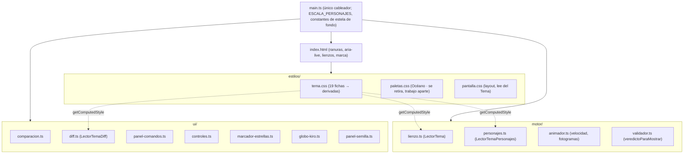

# Design Document

**KiroLogo · Spec 08 · Diseño visual**

## Overview

### 1. Visión general y decisiones

#### 1.1 Qué formaliza esta spec

Esta spec **no construye una arquitectura nueva**. El diseño visual de KiroLogo ya vive en el
repositorio como una propuesta aprobada por el líder y aún sin confirmar; el trabajo aquí es
**describir la arquitectura que ya existe**, **formalizarla como requisitos verificables** y definir
la **estrategia de verificación, conciliación y pruebas** que cierra los diez desvíos con las specs
00 (Cimientos) y 01 (Mundo 0).

La cadena visual que el diseño documenta es la que ya está:

```
index.html  →  estilos/{tema,paletas,pantalla}.css  →  motor/{lienzo,personajes,animador,validador}  →  ui/*
                                           ↑ cableado por src/main.ts ↑
```

El único código que esta spec **añade o ajusta** es, en total, tres cosas:

1. Una **prueba del Tema** (artefacto nuevo) que lee el CSS real y verifica el contraste de la paleta
   Kiro. Hereda y concentra la verificación de contraste que hoy está repartida.
2. Una **prueba de literales de color** sobre `src/motor/` y `src/ui/` (requisito 9.1 y 9.2).
3. El **ajuste de fuentes**: reemplazar el enlace a un servicio de fuentes de otro origen por
   paquetes OFL autoalojados (requisito 6). Este cambio toca `index.html` y `package.json`, y se
   **ejecuta en la fase de implementación, con la aprobación del usuario**, no ahora.

Todo lo demás —el Tema, la Pantalla, los Personajes, el Animador, la Comparación, el Diff, el Panel de
comandos, los Controles, el Marcador de estrellas, el Panel de semilla y la marca— ya está escrito y se
describe como **estado actual**. Las tareas de la fase siguiente son de **verificación, conciliación y
pruebas**, no de construcción.



*Satisface: Requisitos 1, 2, 9.*

#### 1.2 Qué se reusa sin tocar

Todos estos módulos existen y **ninguna tarea de esta spec los modifica**; solo se verifican y se
describen:

- `index.html` — tres columnas, ranuras, única región `aria-live`, lienzos, marca y favicon en línea.
  La única edición futura (fuentes) está acotada en la sección 8.
- `src/estilos/tema.css` — las 19 fichas de la paleta Kiro y sus variables derivadas.
- `src/estilos/pantalla.css` — el layout de tres columnas y el apilado.
- `src/motor/lienzo.ts`, `personajes.ts`, `animador.ts`, `validador.ts`.
- `src/ui/comparacion.ts`, `diff.ts`, `panel-comandos.ts`, `controles.ts`, `marcador-estrellas.ts`,
  `globo-kiro.ts`, `panel-semilla.ts`.
- `src/main.ts` — el cableador. Mantiene a propósito `ESCALA_PERSONAJES` y las constantes de la estela
  de fondo, y queda **excluido** de la prueba de literales de color (sección 2.4).

*Satisface: Requisitos 1, 3, 4, 5, 7, 9.1.*

#### 1.3 Resumen de la conciliación con las specs 00 y 01

Cada desvío del diseño respecto de un criterio de la spec 00 queda cerrado por el requisito indicado,
de una de tres maneras: **enmienda** (esta spec pasa a prevalecer sobre el criterio), **corrección**
(se cambia el diseño para cumplirlo) o **excepción** (se admite el desvío con su justificación).

| # | Desvío del diseño | Criterio 00 | Cierre | Sección |
|---|---|---|---|---|
| 1 | La tortuga vuelve al Estado inicial al terminar o detener | 00·14.8, 00·24.7 | Enmienda | 4 |
| 2 | El lápiz solo se dibuja levantado | 00·13.5 | Enmienda | 4 |
| 3 | No se dibuja la marca de rumbo | 00·13.3 | Enmienda | 4 |
| 4 | Conjunto de personajes a escala 2,4 | 00·13.6 | Enmienda | 4 |
| 5 | El Panel_Comandos muestra como texto visible solo el ejemplo | 00·26.2 | Enmienda | 6 |
| 6 | Las fuentes se pedían a otro origen | 00·27.8 | Corrección | 7 |
| 7 | Logo y mascota como imágenes en `public/marca/` | steering `tecnologia` | Excepción temporal | 6 |
| 8 | La superposición muestra las estelas en Posiciones reales | 00·23.5 | Enmienda | 5 |
| 9 | Controles por debajo de 3:1 frente a su fondo | 00·28.3 | Enmienda | 8 |
| 10 | El foco se muestra con `:focus-visible` | 00·28.6 | Enmienda | 8 |

La decisión de producto **D11 (una sola paleta)** no es un desvío de la spec 00, sino un recorte de
alcance que se refleja en la sección 2.5.

**Regla de no debilitamiento (requisito 9.5):** ninguna prueba heredada de las specs 00 o 01 se
debilita sin una enmienda que lo justifique registrada **tanto en esta spec como en la Bitácora**.
Cada enmienda de la tabla anterior deja rastro en `docs/bitacora.md`. Una prueba de la propia suite
trata como fallo cualquier debilitamiento no registrado, identificando la prueba afectada.

*Satisface: Requisitos 9.5, y las enmiendas/correcciones/excepción de 00.*

#### 1.4 Regla de trabajo del usuario

No se aplica ningún cambio visible sin la aprobación del usuario. Este diseño describe el plan completo,
pero los dos puntos con efecto visible potencial —el **ajuste de fuentes** (`index.html`,
`package.json`) y el **retiro de la segunda paleta**— se tratan así:

- El ajuste de fuentes se ejecuta en implementación, con aprobación explícita (sección 7).
- El retiro del Selector_Paleta, de la paleta Océano, del script en línea de `data-paleta` y de la
  clave de `localStorage` es un **trabajo aparte**: las tareas de esta spec **no tocan ese código**
  (sección 2.5).

## Architecture

Arquitectura del tema y del color. Las secciones 2 a 8 describen, módulo por módulo, la arquitectura
visual ya existente que esta spec formaliza.

### 2. El Tema como única fuente de verdad del color

*Satisface: Requisito 2, Requisito 9.*

#### 2.1 Las 19 fichas y sus derivadas

`tema.css` declara en su **primer bloque** exactamente **19 fichas de color** de la paleta Kiro. Todo
el resto del color de la interfaz, del Lienzo y de los Personajes se **deriva** de esas fichas en el
bloque `[data-paleta]`, siempre por referencia `var(--ficha)`, nunca con un valor de color literal.

| Grupo | Fichas | Conteo |
|---|---|---|
| Superficies | `--tinta-950`, `--tinta-900`, `--tinta-850`, `--tinta-800`, `--tinta-700`, `--tinta-600`, `--tinta-editor`, `--tinta-canaleta` | 8 |
| Color con significado | `--acento`, `--sobre-acento`, `--secundario`, `--suave`, `--coincide`, `--peligro`, `--aviso` | 7 |
| Texto | `--texto`, `--texto-2`, `--texto-3`, `--texto-error` | 4 |
| **Total** | | **19** |

La regla, verificable mecánicamente: **ninguna variable derivada contiene un valor de color literal**
(hexadecimal, `rgb`, `rgba`, `hsl` o nombre CSS) distinto de una referencia a una ficha o de una mezcla
(`color-mix`) de fichas. Hay **dos** conjuntos de excepciones deliberadas:

- **(a) Las variables de reserva** (`*-reserva`) del bloque `:root` que no cambia con la paleta: existen
  precisamente para dar un valor usable si una ficha faltara, y una prueba comprueba que coinciden con lo
  que la paleta Kiro resuelve.
- **(b) Los ocho colores de la mascota y del lápiz**, literales **a propósito** porque **no se derivan de
  las fichas** y **conservan su color en todas las paletas** (la tortuga es la mascota): `--color-tortuga-contorno`,
  `--color-tortuga-relleno`, `--color-tortuga-caparazon`, `--color-tortuga-detalle`, `--color-tortuga-cabeza`,
  `--color-kiro-relleno`, `--color-kiro-ojos` y `--color-lapiz-relleno`. Ni se derivan de las fichas ni se
  cambian de color.

*Satisface: Requisito 2.1.*

#### 2.2 Lectura por `getComputedStyle`

El Lienzo y los Personajes no llevan color escrito: lo leen del Tema en tiempo de repintado mediante
`getComputedStyle`, a través de tres lectores que `main.ts` cablea:

| Lector | Consumidor | Qué lee |
|---|---|---|
| `LectorTema` | `motor/lienzo.ts` | Color de las estelas, color y grosor de la cuadrícula, fondo del lienzo |
| `LectorTemaPersonajes` | `motor/personajes.ts` | Colores y grosores de la tortuga, de Kiro y del lápiz; `--lapiz-mostrar`, `--marca-rumbo-mostrar` |
| `LectorTemaDiff` | `ui/diff.ts` | Color, grosor y patrón de las tres regiones del Diff |

Como las derivadas apuntan **directo a una ficha** sin mezclas en el punto de lectura, el valor que
recibe el contexto 2D ya trae un color resoluble (un `color-mix` sin resolver no lo entienden todos los
navegadores). Consecuencia: cambiar una ficha del Tema se refleja en el siguiente repintado **sin
tocar ningún módulo de TypeScript**.

*Satisface: Requisito 2.2.*

#### 2.3 La regla «ningún color a mano» y su verificación

Ningún módulo de `src/motor/` ni de `src/ui/` escribe un color como literal; todo color sale de una
variable del Tema leída por un lector. La prueba de literales de color (sección 9.3) recorre esos dos
directorios y falla si encuentra un hexadecimal (`#abc`, `#aabbcc`), un `rgb(...)`/`rgba(...)`, un
`hsl(...)`/`hsla(...)` o un nombre CSS de color en una posición de color, **identificando el archivo y
el literal detectado**, sin modificar el módulo.

*Satisface: Requisitos 9.1, 9.2.*

#### 2.4 Exclusión de `main.ts`

`src/main.ts` es el **cableador** y queda **excluido** de la prueba de literales de color: mantiene a
propósito los valores de **reserva** que entrega al lector de tema cuando una variable no resuelve, y
las constantes de presentación `ESCALA_PERSONAJES`, `GROSOR_ESTELA_DE_FONDO`,
`GUIONES_ESTELA_DE_FONDO_REFERENCIA` y `OPACIDAD_ESTELA_DE_FONDO`. La prueba abarca solo `src/motor/` y
`src/ui/`.

*Satisface: Requisito 9.1 (exclusión explícita de `main.ts`).*

#### 2.5 Una sola paleta (D11) — qué se retira, en trabajo aparte

El proyecto se queda **solo con la paleta Kiro**. En consecuencia, dejan de tener sentido:

- `src/ui/selector-paleta.ts` (y su prueba).
- `src/estilos/paletas.css` (la paleta Océano).
- El script en línea de `index.html` que leía `localStorage` `kirologo.paleta` y aplicaba
  `data-paleta`.
- La clave de `localStorage` `kirologo.paleta` (no hay segunda clave de persistencia visual).
- La ranura `ranura-paleta` de `index.html`, que queda **sin pieza de interfaz asignada** en esta spec.

**Nota importante:** el **retiro de ese código es un trabajo aparte**. Las tareas de esta spec **no
tocan** el Selector_Paleta ni las paletas; esta sección solo documenta qué se eliminará después, para
que el inventario quede registrado. Mientras tanto, `main.ts` sigue importando `crearSelectorPaleta` y
la spec no lo altera.

El Tema se describe, a todos los efectos de esta spec, como **una sola paleta**: 19 fichas más sus
derivadas. La verificación de contraste que antes recorría cada paleta se concentra ahora en la
**prueba del Tema** de la paleta Kiro (sección 9.2).

*Satisface: Requisito 2 (decisión D11 reflejada).*

## Estructura de la pantalla

### 3. Ranuras, columnas y encuadre

*Satisface: Requisito 1.*

#### 3.1 Ranuras de `index.html` y cómo `main.ts` las usa

`index.html` aporta los elementos estáticos (la región `aria-live`, la cabecera, los cuadros de los
lienzos con sus `id`) y un conjunto de **ranuras** con identificador fijo. `main.ts` construye el DOM
de cada pieza de `ui/` y lo cuelga de la ranura que le corresponde; **si la ranura no existe, cuelga la
pieza del contenedor raíz `#aplicacion`** sin omitirla ni interrumpir el montaje de las demás.

| Ranura | Pieza de interfaz | Columna |
|---|---|---|
| `programa` | Globo_Kiro + Editor + Controles + Panel_Comandos | centro |
| `ranura-comparacion` | botón «Comparar con Kiro» | derecha (junto al título «Tu figura») |
| `ranura-leyenda` | leyenda del Diff | derecha (sobre el pie de la superposición) |
| `ranura-reto` | Panel_Semilla | izquierda (bajo la figura de Kiro) |
| `ranura-marcador` | Marcador_Estrellas | derecha (bajo la figura del jugador) |
| `ranura-ruta` | ruta de niveles | cabecera (estado actual, lo sustituye la spec 09) |
| `ranura-paleta` | — | cabecera (queda sin pieza, ver §2.5) |

La escena es de **tres columnas**: figura de Kiro a la izquierda (con `ranura-reto` debajo), sección
del programa al centro (todo dentro de `programa`), figura del jugador a la derecha (con
`ranura-comparacion` junto al título, `ranura-leyenda` sobre el pie y `ranura-marcador` abajo).

*Satisface: Requisitos 1.1, 1.2, 1.3, 1.4.*

#### 3.2 Región `aria-live` única

`index.html` declara un **único** elemento `aria-live`: `#anuncios`, con `aria-live="polite"` y
`aria-atomic="true"`. Es el único canal de anuncios de estado; ninguna otra pieza declara una segunda
región `aria-live`. La prueba de estructura verifica que no aparece un segundo `aria-live` en el
documento servido.

*Satisface: Requisito 1.8.*

#### 3.3 Breakpoints y encuadre

El layout de tres columnas y el apilado viven en `pantalla.css`, que **lee los colores del Tema y nunca
los repite**. Tres puntos de ruptura fijan el encuadre:

| Área de contenido | Comportamiento exigido |
|---|---|
| 1440 × 900 | Cabecera y las tres columnas completas, **sin ningún desplazamiento** vertical ni horizontal |
| 1366 × 768 | Desplazamiento vertical ≤ 8 px; **sin** desplazamiento horizontal |
| < 720 px de ancho | Apila en una sola columna, en orden: cabecera, figura de Kiro, programa, figura del jugador; sin recortes ni desplazamiento horizontal |

**Cómo se verifica, con honestidad sobre los límites de la automatización.** El encuadre real —que a
1440 × 900 no aparezca barra de desplazamiento— depende del motor de maquetado del navegador, que una
prueba en jsdom **no** calcula: jsdom no hace layout, no mide alturas ni dispara `scrollHeight` real.
Por eso la verificación es de dos niveles:

1. **Automatizada (lo que sí se puede comprobar):** una prueba de estructura confirma que
   `pantalla.css` declara las reglas de las tres columnas y las de apilado bajo las *media queries*
   correspondientes (existencia de la regla de columnas, de la regla `@media (max-width: …)` que
   colapsa a una columna y del orden de apilado). Esto garantiza que las reglas existen, no que el
   resultado pintado quepa.
2. **Manual (lo que la prueba no puede medir):** una verificación manual a los tres tamaños
   (1440 × 900, 1366 × 768 y un ancho < 720 px), documentada en la Bitácora, confirma el encuadre
   real y la ausencia o el límite del desplazamiento.

El diseño no pretende que «las pruebas verdes» equivalgan a encuadre correcto: declara explícitamente
qué comprueba la máquina y qué queda a la revisión manual.

*Satisface: Requisitos 1.5, 1.6, 1.7.*

#### 3.4 La ruta de niveles es estado actual (la sustituye la spec 09)

La cabecera incluye hoy una ruta de niveles (`ranura-ruta`) que muestra «Mundo N · Nombre» con la
medalla de la insignia de concepto, y que recorta con puntos suspensivos el nombre de un nivel que no
cabe, conservándolo completo en el nombre accesible. **Nada de esto es requisito de esta spec:** se deja
constancia como estado actual que la spec 09 reemplaza. El diseño **no fija** su estructura.

*Satisface: Requisito 1 (ruta como estado actual, fuera de alcance).*

## Personajes y movimiento

### 4. Tortuga, Kiro y lápiz

*Satisface: Requisito 3, y las enmiendas 00·13.3, 00·13.5, 00·13.6, 00·14.8, 00·24.7.*

#### 4.1 Dibujo con Canvas 2D y lectura del Tema

`personajes.ts` dibuja la tortuga (caparazón de escudos y piel), con Kiro montado encima, y el lápiz,
**únicamente con trazos y rellenos de Canvas 2D** —sin imágenes, sprites ni SVG—, leyendo del Tema el
color y el grosor de cada trazo por `LectorTemaPersonajes`. No hay ningún valor de color literal en el
módulo. La tortuga conserva su verde en todas las paletas (`--color-tortuga-*`), por ser la mascota.

*Satisface: Requisito 3.1.*

#### 4.2 Escala 2,4 — decisión de presentación en `main.ts`

El conjunto tortuga + Kiro + lápiz se dibuja a **escala 2,4** respecto del círculo de 40 unidades de
diámetro que declara 00·13.6. Esa escala es una **decisión de presentación** y por eso vive en
`main.ts` como la constante `ESCALA_PERSONAJES = 2.4`, no en `personajes.ts`: la geometría de los
personajes mide ~25 unidades en un espacio de 800, y sin el agrandado la tortuga quedaría en ~13 px y no
se leería como personaje.

En el **Nivel 0.1**, cuya figura es un tramo abierto que termina lejos del Estado inicial, la silueta de
la tortuga en reposo **no se solapa** con el extremo final del trazo. La garantía se limita al 0.1
porque en las figuras cerradas (p. ej. el cuadrado del 0.4) el trazo termina en el punto de partida,
donde la tortuga descansa. Esto **enmienda 00·13.6**.

*Satisface: Requisito 3.2 (enmienda 00·13.6).*

#### 4.3 Semántica de `--lapiz-mostrar` y `--marca-rumbo-mostrar`

Dos variables del Tema gobiernan qué se dibuja sobre la tortuga:

- `--lapiz-mostrar`: con valor `arriba`, `personajes.ts` dibuja el lápiz **únicamente en su posición
  levantada**; con cualquier otro valor o **sin** valor, lo dibuja en sus **dos** posiciones, abajo y
  arriba. Hoy vale `arriba`: con el lápiz abajo la estela ya comunica que escribe, así que solo importa
  hacer visible el acto de **levantarlo**. Esto **enmienda 00·13.5**.
- `--marca-rumbo-mostrar`: con valor `no`, **no se dibuja ninguna marca de rumbo**; la cabeza de la
  tortuga ya comunica el rumbo. Hoy vale `no`. Esto **enmienda 00·13.3**.

*Satisface: Requisitos 3.3 (enmienda 00·13.5), 3.4 (enmienda 00·13.3).*

#### 4.4 Animación, velocidades y resaltado de línea

Cuando el jugador ejecuta su programa, el `Animador` anima la tortuga fotograma a fotograma a la
velocidad seleccionada —**lenta** (1000 ms/Operacion), **normal** (400 ms), **rápida** (120 ms) e
**inmediata** (0 ms)—, dibujando la estela conforme avanza, y el `Editor` resalta la línea de la
Operacion en curso.

*Satisface: Requisito 3.5.*

#### 4.5 Evaluación al terminar de dibujarse, no al pulsar ejecutar

Cuando el Animador aplica la **última** Operacion y termina de dibujar su estela, `main.ts` entrega la
secuencia **completa** a las Estrellas para calificar. El juego **no** califica en el instante de pulsar
«ejecutar»: lo que se valida es exactamente lo que el jugador vio dibujarse.

*Satisface: Requisito 3.6.*

#### 4.6 Vuelta al Estado inicial al terminar o detener

Cuando una ejecución termina, o si el jugador la detiene, el juego **devuelve la tortuga al Estado
inicial del Nivel** (en el 0.1, el centro con rumbo 0) conservando intacta la estela ya dibujada. Esto
**enmienda 00·14.8 y 00·24.7**, que dejaban la tortuga donde acabó; se prefiere el reposo en el inicio
porque el solapamiento con la punta del trazo se evitó al fijar la escala (§4.2).

*Satisface: Requisito 3.7 (enmienda 00·14.8, 00·24.7).*

#### 4.7 `prefers-reduced-motion`

Mientras `prefers-reduced-motion` es `reduce`, el Animador dibuja **de golpe** la estela completa sin
posiciones intermedias, deja la tortuga en el Estado inicial y mantiene disponible el **modo paso a
paso** aplicando exactamente una Operacion por paso. `main.ts` recibe la consulta de movimiento reducido
por parámetro, de modo que esta conducta se prueba en jsdom sin `requestAnimationFrame`.

*Satisface: Requisito 3.8.*

## Comparación y diff

### 5. Superposición, veredicto de presentación y estrellas

*Satisface: Requisito 4, y la enmienda 00·23.5.*

#### 5.1 Dos vistas y el control que alterna

La `Comparacion` presenta, junto al título de la figura del jugador, un control que alterna entre
**exactamente dos** vistas —**lado a lado** y **superposición**— y expone cuál está en curso mediante el
**estado presionado** del propio control, no solo por color.

*Satisface: Requisito 4.1.*

#### 5.2 Apertura automática al negarse la precisión

Si al terminar una ejecución las Estrellas niegan la precisión, la `Comparacion` pasa **por su cuenta** a
la vista de superposición con el Diff dibujado y deja el control en estado presionado, sin que el jugador
active nada.

*Satisface: Requisito 4.2.*

#### 5.3 `veredictoParaMostrar`: posiciones reales vs. alineada

En la superposición se dibujan las **dos estelas en un solo lienzo**, y el `Diff` colorea los **trazos
reales** de cada figura según su región, aplicando la **transformación del veredicto de presentación**
que devuelve `veredictoParaMostrar` de `validador.ts`. Esa función elige, entre:

- el veredicto de las **Posiciones reales** (lo que el jugador vio dibujar, sin centrar ni girar), y
- el veredicto de la **Alineación del Validador** (la figura llevada sobre la de referencia),

**el que tenga mayor coincidencia** (IoU). El empate se resuelve a favor de las Posiciones reales,
que son las que el jugador está mirando. Esto **enmienda 00·23.5**, que mostraba siempre la vista
alineada.

**Separación clave:** `veredictoParaMostrar` decide solo **qué se pinta**. Las Estrellas salen
**siempre** del **veredicto oficial** del Validador, con independencia del veredicto de presentación y
de la vista en curso.

*Satisface: Requisitos 4.3 (enmienda 00·23.5), 4.5.*

#### 5.4 Las tres regiones del Diff y las estelas de fondo

El `Diff` dibuja la **coincidencia** en línea verde continua, el **exceso** en rojo con grosor de al
menos el **doble** del de la coincidencia, y la **falta** en gris **punteado**, tomando color, grosor y
patrón del Tema (`LectorTemaDiff`), de modo que las tres regiones se distingan por **patrón** y por
**grosor** además de por color.

Bajo esas tres regiones, la superposición pinta las dos estelas como fondo tenue para dar contexto. Cómo
se ven esas estelas de fondo (finas, tenues, la de Kiro a trazos) es una **decisión de presentación** y
vive en `main.ts` como las constantes `GROSOR_ESTELA_DE_FONDO`, `GUIONES_ESTELA_DE_FONDO_REFERENCIA` y
`OPACIDAD_ESTELA_DE_FONDO`, no en el Tema.

*Satisface: Requisito 4.4.*

#### 5.5 Estado sin estela del jugador

Cuando el jugador no ha ejecutado ningún programa, o su última ejecución no encendió coincidencia ni
exceso, la `Comparacion` presenta el lienzo del jugador con cuadrícula y **sin estela**, el `Diff` dibuja
**solo la falta**, el control de comparación permanece **operable**, y la `Comparacion` **anuncia por la
Región_Anuncios** que todavía no hay estela del jugador que comparar.

*Satisface: Requisito 4.6.*

## Panel de comandos, controles, estrellas, semilla y marca

### 6. Las piezas de interfaz del intento

*Satisface: Requisitos 5, 7, y las enmiendas 00·26.2 y la excepción temporal al steering `tecnologia`.*

#### 6.1 Panel de comandos

El `Panel_Comandos` se presenta como una **barra de herramientas** con una **sola parada de Tab**
(exactamente un botón en el orden de tabulación a la vez) y lleva el foco fuera con una sola pulsación de
Tab. Dentro, el foco se mueve con las flechas `ArrowUp`/`ArrowDown`/`ArrowLeft`/`ArrowRight`, y salta al
primer y último botón con `Inicio` y `Fin`.

Como **texto visible permanente** muestra únicamente el **ejemplo de uso** de cada comando; el nombre
largo, la abreviatura y la descripción se **revelan al pasar el cursor o al enfocar**. Esto **enmienda
00·26.2**, que exigía mostrarlos también como texto permanente. El **nombre accesible** de cada botón
incluye, completos y carácter por carácter, el nombre largo, la abreviatura, la descripción **y** el
ejemplo.

Si el vocabulario desbloqueado del Nivel en curso está vacío, el panel se presenta **sin botones** y sin
lanzar excepción. Al activar un botón (ratón, `Enter` o barra espaciadora), el `Editor` inserta el
ejemplo de uso en la posición del cursor y el panel **conserva el foco** en el botón activado.

*Satisface: Requisitos 5.1, 5.2, 5.3, 5.4 (enmienda 00·26.2), 5.5, 5.6, 5.7.*

#### 6.2 Controles

Los `Controles` presentan cada una de sus **cinco acciones** (ejecutar, detener, dar un paso, reiniciar,
volver a ver la demostración) como un **botón nativo** con icono y etiqueta corta en español, alcanzable
por teclado en orden visual, con la etiqueta corta contenida en el nombre accesible.

La velocidad es un grupo de **exactamente cuatro** botones (lenta, normal, rápida, inmediata), con
**exactamente uno** seleccionado a la vez, marcado por **estado presionado y por clase**, nunca solo por
color. Al entrar a un nivel, la velocidad **normal** es la única seleccionada.

*Satisface: Requisitos 7.1, 7.2, 7.3.*

#### 6.3 Marcador de estrellas

El `Marcador_Estrellas` presenta las tres estrellas (precisión, economía, abstracción) como **tres
tarjetas**, cada una distinguible por **forma** (★ otorgada, ☆ pendiente o negada), por **texto** del
estado en español y por **color**, de modo que **dos de esos tres canales basten** para distinguirlas
sin depender solo del color.

*Satisface: Requisito 7.4.*

#### 6.4 Panel de semilla

El `Panel_Semilla` se presenta en la ranura bajo la figura de Kiro (`ranura-reto`). Muestra el **código
del Reto** en un elemento **`<output>`** con nombre accesible, **seleccionable por teclado**, junto con
las acciones de **pedir otro reto** y de **reproducir un código**. Si el nivel en curso es **autorado**
(no generado), el panel **deshabilita** ambas acciones e **indica por texto** —no solo por color— que el
reto es fijo.

*Satisface: Requisitos 7.5, 7.6.*

#### 6.5 Logo y mascota — excepción temporal al steering

El juego presenta el **logo** y la **mascota** como imágenes de **boceto** en `public/marca/`, **fuera
del control de versiones**, como **excepción temporal** al steering `tecnologia` (que prohíbe activos
gráficos) hasta que el líder decida. La **Bitácora registra** la excepción y su carácter temporal. El
nombre **KiroLogo** queda disponible como **texto accesible** del logo por el atributo `alt`, de modo que
el nombre no depende de que la imagen cargue.

*Satisface: Requisitos 7.7, 7.8.*

## Fuentes sin solicitudes a otro origen

### 7. Tipografía OFL autoalojada

*Satisface: Requisito 6, y la corrección de 00·27.8.*

#### 7.1 El problema que se corrige

Hoy `index.html` enlaza un servicio de fuentes de **otro origen**: dos `preconnect`
(`fonts.googleapis.com`, `fonts.gstatic.com`) y un `stylesheet` que trae **Bricolage Grotesque** y
**JetBrains Mono**. Eso **incumple 00·27.8** (cero solicitudes a otro origen durante el flujo del Nivel
0.1) y hace que privacidad y funcionamiento dependan de un tercero. Esta spec lo **corrige**.

#### 7.2 Estrategia aprobada: paquetes npm OFL autoalojados

Las dos familias se sirven desde el **propio origen** mediante paquetes npm de fuentes variables, con
**versión fija** (exacta, sin rangos) y licencia **OFL**, compatible con la redistribución MIT del
repositorio. Regla del proyecto que lo respalda —`docs/README.md`, «Definición de terminado, común a
todas»: *toda dependencia nueva va con versión fija y con licencia compatible con MIT*. OFL es
compatible: aplica a los **archivos de fuente**, no impone copyleft al código, por lo que no contamina el
bundle bajo MIT. No hace falta cambiar el README.

| Rol | Paquete | Licencia | Ejes a conservar |
|---|---|---|---|
| Título e interfaz | `@fontsource-variable/bricolage-grotesque` | OFL | peso 400–800 y tamaño óptico (`opsz`) |
| Código | `@fontsource-variable/jetbrains-mono` | OFL | pesos 400, 500 y 700 |

Ambos se importan como **CSS** que **Vite** empaqueta y emite como activos con **hash** servidos desde el
propio origen. Se declaran como **`devDependencies`** (no `dependencies`), porque **Vite las compila
dentro del bundle en tiempo de build** y el proyecto **no tiene dependencias de runtime**: son
dependencias de desarrollo/compilación. La **versión exacta se fija al añadir el paquete**, en la fase de
implementación. El diseño registra la licencia de cada paquete.

**Conservar los mismos ejes** garantiza que la letra se vea igual que hoy: la variable de Bricolage
mantiene su eje de peso y su `opsz`; JetBrains Mono mantiene 400/500/700. La **pila de fuentes del
sistema** declarada en `tema.css` (`--fuente-titulo`, `--fuente-ui`, `--fuente-codigo`) queda como
**reserva**: si ninguna familia autoalojada está disponible al renderizar, el texto se presenta con esa
pila, legible y operable, **sin** emitir ninguna solicitud a otro origen.

*Satisface: Requisitos 6.1, 6.2, 6.3.*

#### 7.3 Cómo el reemplazo elimina las solicitudes externas

En implementación, con la aprobación del usuario:

1. Se **eliminan** de `index.html` las dos `preconnect` y el `stylesheet` a `fonts.googleapis.com` /
   `fonts.gstatic.com`.
2. Se **importa** el CSS de los dos paquetes Fontsource (en el punto de entrada o en una hoja del
   proyecto), de modo que Vite incluya las fuentes como activos del propio origen.

Resultado: durante el flujo del Nivel 0.1, desde la carga de `index.html` hasta la demostración completa
de Kiro, el juego emite **cero** solicitudes a cualquier origen distinto del que sirve `index.html`,
incluidas fuentes, hojas de estilo y preconexiones. Una **revisión del documento servido** falla la
verificación si encuentra enlaces o preconexiones a un origen de fuentes distinto del propio
(incumplimiento de 00·27.8).

*Satisface: Requisitos 6.1, 6.4.*

#### 7.4 Regla de trabajo

Este es el **único** cambio con efecto visible potencial de la spec, y ya está acordado con el usuario.
`index.html` y `package.json` se **tocan en implementación**, no ahora, y bajo su aprobación. El diseño
solo describe el plan.

## Accesibilidad

### 8. Foco, contraste y canal además del color

*Satisface: Requisito 8, y las enmiendas 00·28.3 y 00·28.6.*

#### 8.1 Indicador de foco con `:focus-visible`

El indicador de foco se muestra según **`:focus-visible`**, el comportamiento **estándar** para el foco,
que ya venía en el Tema desde la spec 00 (grosor 3 px, color `--aviso`). Cuando se muestra en un elemento
interactivo, es un indicador visible de **2 px o más** y con contraste WCAG 2.1 de **3:1 o mayor** frente
al fondo adyacente. Esto **enmienda 00·28.6**, que exigía mostrar el foco con independencia de si llegó
por teclado o por puntero; se usa `:focus-visible` por ser el estándar y por venir ya así en la base.

*Satisface: Requisito 8.1 (enmienda 00·28.6).*

#### 8.2 Contraste de controles acotado a lo necesario

El juego mantiene contraste WCAG 2.1 de **3:1 o mayor** entre su fondo adyacente y cada elemento
interactivo de los Controles, del Panel_Comandos y del Editor **que necesite ese contraste para
identificarse como control**. Esto **enmienda 00·28.3**, que lo exigía a **todo** borde y fondo de
control: el diseño aprobado por el líder conserva el aspecto actual (medido entre 1,07:1 y 2,07:1) y
acota la exigencia a los elementos que la necesitan para identificarse como control.

*Satisface: Requisito 8.2 (enmienda 00·28.3).*

#### 8.3 Contraste de texto y de trazos

- **Texto:** 4.5:1 o mayor entre todo texto visible y su fondo adyacente.
- **Trazos sobre el lienzo:** 3:1 o mayor, evaluado **por separado**, entre el fondo del Lienzo y cada
  uno de: la estela del jugador, la estela de referencia, cada una de las tres regiones del Diff y el
  conjunto de la tortuga con Kiro.

La **prueba del Tema** mide estos contrastes leyendo el **CSS real**: resuelve el valor de las fichas y
derivadas implicadas y aplica el **algoritmo de relación de contraste WCAG 2.1** (luminancia relativa de
cada color, razón `(L1 + 0.05) / (L2 + 0.05)`) sobre los pares que exige el requisito. Verifica, en la
paleta Kiro: cada par texto/fondo ≥ 4.5:1; cada estela y trazo frente al fondo del lienzo ≥ 3:1; el
indicador de foco ≥ 3:1 frente a su fondo adyacente.

*Satisface: Requisitos 8.3, 8.4, 2.3.*

#### 8.4 Un canal además del color

Cada estado de la retroalimentación se comunica por **al menos un canal además del color** —texto en
español, forma, patrón de guiones o grosor de línea—: las tres regiones del Diff (patrón y grosor, §5.4);
cada Estrella otorgada o negada (forma ★/☆ y texto, §6.3); el estado habilitado o deshabilitado de cada
acción de los Controles (estado presionado y texto); y el estado del lápiz de la tortuga, que se comunica
por **forma/presencia** (§4.3): el lápiz **dibujado** significa que está **levantado**, y **sin lápiz
dibujado** significa que está **abajo** (coherente con `--lapiz-mostrar=arriba`).

*Satisface: Requisito 8.5.*

## Components and Interfaces

### 8bis. Componentes e interfaces (estado actual)

Esta spec no introduce módulos nuevos salvo los artefactos de prueba. Los componentes visuales ya
existen; la tabla reúne cada uno, su interfaz pública relevante y la sección donde se describe su papel.

| Componente | Archivo | Interfaz / punto de entrada | Sección |
|---|---|---|---|
| Tema | `estilos/tema.css` | 19 fichas + derivadas, leídas por `getComputedStyle` | 2 |
| Pantalla | `index.html` + `estilos/pantalla.css` | ranuras, región `aria-live`, media queries | 3 |
| Lienzo | `motor/lienzo.ts` | `crearLienzo`, `dibujarEstela`, `dibujarCuadricula`, `LectorTema` | 2.2, 5 |
| Personajes | `motor/personajes.ts` | `dibujarPersonajes`, `LectorTemaPersonajes` | 4 |
| Animador | `motor/animador.ts` | `crearAnimador`, `Velocidad`, `Fotograma` | 4.4, 4.7 |
| Validador | `motor/validador.ts` | `validar`, `veredictoParaMostrar`, `Veredicto` | 5.3 |
| Comparacion | `ui/comparacion.ts` | `crearComparacion` | 5 |
| Diff | `ui/diff.ts` | `crearDiff`, `LectorTemaDiff` | 5.4 |
| Panel_Comandos | `ui/panel-comandos.ts` | `crearPanelComandos` | 6.1 |
| Controles | `ui/controles.ts` | `crearControles` | 6.2 |
| Marcador_Estrellas | `ui/marcador-estrellas.ts` | `crearMarcadorEstrellas` | 6.3 |
| Panel_Semilla | `ui/panel-semilla.ts` | `crearPanelSemilla` (`<output>`) | 6.4 |
| Globo_Kiro | `ui/globo-kiro.ts` | `crearGloboKiro` | 1.1 |
| Cableador | `main.ts` | `crearAplicacion`, cablea todas las piezas; único que las conoce | 1.1, 2.4 |

**Contrato de cableado.** `main.ts` es el único módulo que conoce a todos los demás: resuelve el reto,
crea el lienzo y el animador, instancia las piezas de `ui/` y las cuelga de sus ranuras. Los módulos de
`ui/` **no se hablan entre sí**, solo con `main.ts` a través de callbacks. Las dependencias del entorno
(documento, almacenamiento, relojes, consulta de movimiento reducido) entran por parámetro, de modo que
la aplicación entera se prueba en jsdom sin `requestAnimationFrame`, sin `localStorage` real y sin Canvas
real.

*Satisface: Requisitos 1.1, 1.2, 1.4.*

## Data Models

### 8ter. Modelos de datos

Esta spec es de presentación: no define entidades persistidas nuevas. Los modelos de datos relevantes
son las variables del Tema y los tipos de lectura/veredicto que las piezas visuales consumen; todos ya
existen.

**Fichas del Tema (19).** El modelo de datos del color es el conjunto de fichas de `tema.css`:

| Grupo | Fichas |
|---|---|
| Superficies (8) | `--tinta-950`, `--tinta-900`, `--tinta-850`, `--tinta-800`, `--tinta-700`, `--tinta-600`, `--tinta-editor`, `--tinta-canaleta` |
| Significado (7) | `--acento`, `--sobre-acento`, `--secundario`, `--suave`, `--coincide`, `--peligro`, `--aviso` |
| Texto (4) | `--texto`, `--texto-2`, `--texto-3`, `--texto-error` |

De ellas se derivan, por `var()`/`color-mix`, todas las variables de interfaz, de lienzo y de personajes,
con **dos** conjuntos de excepciones deliberadas que son literales a propósito (§2.1): las variables de
reserva (`*-reserva`) y los ocho colores de la mascota y del lápiz (`--color-tortuga-contorno`,
`--color-tortuga-relleno`, `--color-tortuga-caparazon`, `--color-tortuga-detalle`, `--color-tortuga-cabeza`,
`--color-kiro-relleno`, `--color-kiro-ojos`, `--color-lapiz-relleno`), que no se derivan de las fichas y
conservan su color en todas las paletas. Dos variables de control del dibujo de personajes son parte del
modelo: `--lapiz-mostrar` (`arriba` | otro | ausente) y `--marca-rumbo-mostrar` (`no` | otro).

**Tipos de lectura y veredicto (ya existentes, no se modifican):**

- `LectorTema`, `LectorTemaPersonajes`, `LectorTemaDiff` — funciones que resuelven color y grosor por
  `getComputedStyle`.
- `Veredicto` — veredicto geométrico del Validador; `veredictoParaMostrar(oficial, …)` devuelve el
  veredicto de **presentación** (posiciones reales o alineado) sin alterar el **oficial** del que salen
  las Estrellas.
- `Calificacion` — las tres estrellas (precisión, economía, abstracción), que el Marcador presenta.

**Persistencia.** El único estado persistido sigue siendo el **progreso** en `localStorage` (sin cambios
en esta spec). Con D11 desaparece la clave `kirologo.paleta`, pero su retiro es trabajo aparte (§2.5).

*Satisface: Requisitos 2.1, 4.5.*

## Error Handling

### 8quater. Manejo de situaciones de borde

El manejo de errores de ejecución del lenguaje (guardas de pasos, recursión, tiempo; mensajes en
`src/lenguaje/errores.ts`) es herencia de la spec 00 y queda fuera del alcance de esta spec. Lo que esta
spec fija son las **situaciones de borde de la presentación**, todas ya resueltas en el código:

| Situación | Conducta exigida | Sección |
|---|---|---|
| Una pieza no encuentra su ranura | Se cuelga del contenedor raíz `#aplicacion`, sin omitirla ni interrumpir el montaje de las demás | 3.1 |
| Vocabulario desbloqueado vacío | El Panel_Comandos se presenta sin botones y **sin lanzar excepción** | 6.1 |
| No hay estela del jugador que comparar | Lienzo con cuadrícula sin estela, Diff solo con la falta, control operable, aviso por la Región_Anuncios | 5.5 |
| Ninguna fuente autoalojada disponible | Se usa la pila de fuentes del sistema como reserva, sin solicitudes a otro origen | 7.2 |
| La imagen del logo no carga | El nombre KiroLogo sigue disponible por el `alt` | 6.5 |
| `prefers-reduced-motion: reduce` | La estela se dibuja de golpe; el paso a paso sigue disponible | 4.7 |

*Satisface: Requisitos 1.2, 5.6, 4.6, 6.3, 7.8, 3.8.*

## Testing Strategy

### 9. Estrategia de pruebas

*Satisface: Requisitos 2.3, 6.4, 9.1, 9.2, 9.5.*

#### 9.1 Naturaleza de la verificación en esta spec

Como esta spec **formaliza un diseño existente**, la mayor parte de las pruebas **ya existen** (heredadas
de las specs 00 y 01) y se **conservan**. El trabajo de pruebas de esta spec es: concentrar la
verificación de contraste en una prueba del Tema, añadir la prueba de literales de color, verificar que
el documento no enlaza orígenes de fuentes externos, y **registrar en la Bitácora** cada enmienda.

**«Que las pruebas pasen» no basta como prueba de cumplimiento.** Lo que una prueba automatizada no puede
medir —el encuadre real a cada tamaño, la lectura visual de los personajes, la calidad del foco pintado—
se verifica de forma **manual** y se documenta. El diseño es explícito sobre esa frontera (ver §3.3).

#### 9.2 Prueba del Tema (artefacto nuevo)

Lee `tema.css` real y verifica, para la paleta Kiro:

- Que el primer bloque declara **exactamente 19 fichas** y que **ninguna variable derivada** contiene un
  color literal distinto de una referencia o mezcla de fichas (sección 2.1). La prueba **excluye
  explícitamente** los dos conjuntos de excepciones deliberadas: las variables de reserva (`*-reserva`) y
  los ocho colores de la mascota y del lápiz (`--color-tortuga-contorno`, `--color-tortuga-relleno`,
  `--color-tortuga-caparazon`, `--color-tortuga-detalle`, `--color-tortuga-cabeza`, `--color-kiro-relleno`,
  `--color-kiro-ojos`, `--color-lapiz-relleno`). La prueba conoce esa lista y **no** marca sus literales
  como fallo.
- **Contraste** por el algoritmo WCAG 2.1 (§8.3): pares texto/fondo ≥ 4.5:1; estelas y trazos frente al
  fondo del lienzo ≥ 3:1; indicador de foco ≥ 3:1.
- Que los valores de **reserva** coinciden con lo que la paleta Kiro resuelve.

Esta prueba **recoge** la verificación de contraste que antes vivía por paleta (`selector-paleta.test.ts`
leía `paletas.css`); con D11 (una sola paleta) se concentra aquí.

#### 9.3 Prueba de literales de color (artefacto nuevo)

Recorre `src/motor/` y `src/ui/` y **falla** si un módulo contiene un color escrito como literal
(hexadecimal, `rgb`/`rgba`, `hsl`/`hsla` o nombre CSS en posición de color), **identificando el archivo y
el literal detectado**, sin modificar el módulo. **Excluye `src/main.ts`** (sección 2.4).

#### 9.4 Verificación del documento servido (fuentes)

Una revisión de `index.html` **falla** si declara enlaces o preconexiones a un origen de fuentes distinto
del propio (`fonts.googleapis.com`, `fonts.gstatic.com` u otro). Tras el ajuste de la sección 7, esta
verificación pasa.

#### 9.5 Pruebas de estructura y de estado heredado

- **Estructura de `index.html`:** una sola región `aria-live` (§3.2); existencia de las ranuras y de los
  `id` de los lienzos; existencia de las reglas de columnas y de apilado en `pantalla.css` (§3.3).
- **No debilitamiento (requisito 9.5):** una prueba trata como **fallo** cualquier debilitamiento de una
  prueba heredada de 00/01 **sin** enmienda registrada en esta spec **y** en la Bitácora, identificando
  la prueba afectada.
- **Integración de mundos futuros (requisito 9.3, 9.4):** las ranuras existentes conservan identificador,
  orden y anidamiento; un mundo nuevo se integra sin agregar, eliminar ni modificar declaraciones de
  `tema.css` ni reglas de `pantalla.css` ajenas a sus propias clases.

#### 9.6 Herramientas y configuración

Se usan las herramientas ya fijadas en `package.json`, con **versiones exactas**: **Vitest 5.0.0** como
runner (`npm test` ejecuta `vitest --run`), **jsdom 30.0.1** para el DOM, **fast-check 4.9.0** para las
propiedades, **TypeScript 7.0.2** y **Vite 8.2.2**. No se añaden dependencias de prueba nuevas.

## Correctness Properties

*Una propiedad es una característica o conducta que debe cumplirse en todas las ejecuciones válidas del
sistema: un enunciado formal de lo que el sistema debe hacer. Las propiedades son el puente entre la
especificación legible y la garantía de corrección verificable por máquina.*

Esta spec es mayormente **presentación y configuración declarativa** (CSS, estructura de `index.html`,
layout, verificación de contraste leyendo el CSS real), para lo que las pruebas apropiadas son
**example-based**, **de estructura** y **de contraste**, no propiedades universales. Hay, sin embargo,
dos características puntuales que sí se expresan como propiedad universal sobre su espacio de entrada.

### Property 1: El veredicto de presentación nunca empeora la coincidencia

*Para toda* figura del jugador y figura de referencia, el veredicto que devuelve `veredictoParaMostrar`
tiene una coincidencia (IoU) **mayor o igual** que la del veredicto oficial, y además **las Estrellas no
cambian**: la calificación sale siempre del veredicto oficial, con independencia del veredicto de
presentación elegido.

**Validates: Requirements 4.3, 4.5**

### Property 2: Idempotencia del repintado ante el mismo tema

*Para toda* figura y para todo valor de las fichas del Tema, repintar dos veces con los mismos valores del
Tema (sin cambiar ninguna ficha entre ambos repintados) produce el mismo dibujo: el color y el grosor de
cada trazo son función únicamente de las fichas leídas por `getComputedStyle`, no de estado acumulado.

**Validates: Requirements 2.2**

Ambas propiedades se implementan con un **único** test de propiedad cada una, con **fast-check** y un
**mínimo de 100 iteraciones**, etiquetadas con **Feature: 08-diseno-visual, Property N: {texto}**.
