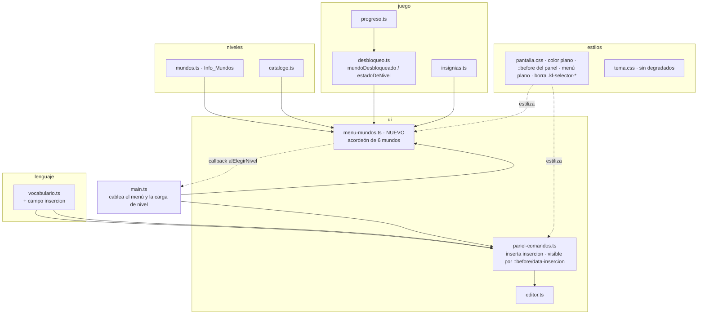
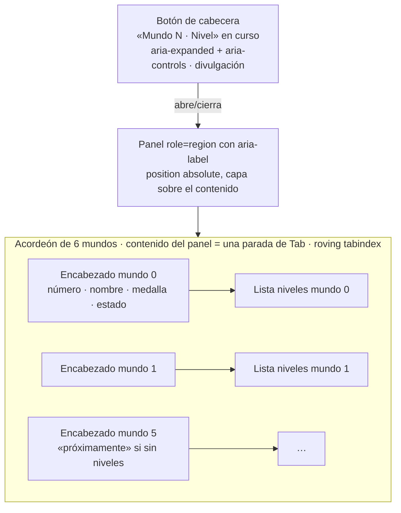

# Design Document

**KiroLogo · Spec 09 · Ajustes de interfaz**

## Overview

Esta spec hace **tres ajustes acotados** sobre la pantalla que ya existe (estado aprobado por la spec
08), sin tocar nada fuera de su alcance. El diseño está anclado al código real; cuando propone una API
nueva, lo dice explícitamente como nueva.

Los tres ajustes:

1. **Atajos de movimiento sin cantidad.** Se añade un campo `insercion` a `EntradaVocabulario`. El
   `Panel_Comandos` pasa a **insertar** `insercion` en vez de `ejemplo`, y el texto **visible** del botón
   pasa a salir de un pseudoelemento CSS (`.kl-comando::before` alimentado por un atributo
   `data-insercion`), sin tocar el `textContent` ni los trozos del botón, para no romper las pruebas de
   fidelidad del DOM. Para los cuatro `Atajo_Movimiento` lo insertado y lo visible es el nombre del
   comando (con un espacio al insertar), sin número. El `ejemplo` con cantidad no cambia: sigue
   alimentando el trozo `.kl-comando-ejemplo` (oculto a la vista), la descripción y el nombre accesible.
   `vocabulario.ts` sigue siendo la única fuente de verdad de lo que un botón inserta.
2. **Colores planos.** Se retiran de `pantalla.css` los degradados de color del `body`, el `drop-shadow`
   del logo, el glow con desenfoque del botón en curso, el `radial-gradient` y el glow de la medalla, y
   el `linear-gradient` sin uso de `.kl-pluma`. Se conservan, como excepciones documentadas, el
   `drop-shadow` de las dos estelas y el `text-shadow` de la estrella otorgada. Una `Prueba_Color_Plano`
   lee el texto de `pantalla.css` y `tema.css` y falla si reaparece un efecto prohibido.
3. **Menú de mundos desplegable.** Un módulo nuevo `src/ui/menu-mundos.ts` reemplaza la presentación en
   fila de un solo mundo de `selector-nivel.ts` por un menú superpuesto con los seis mundos de concepto
   en acordeón, cada uno desplegando sus niveles, para poder ir de un mundo a otro.

### Principios de diseño que gobiernan los tres ajustes

- **Una sola fuente de verdad.** El texto que inserta un botón sale de `vocabulario.ts`; la
  disponibilidad de un mundo o un nivel sale de `desbloqueo.ts`; el nombre y la insignia de un mundo
  salen de `mundos.ts` (`Info_Mundos`); los niveles de un mundo salen de `catalogo.ts`. El menú no
  guarda estado propio del juego: lo deriva.
- **Reglas de importación intactas.** `menu-mundos.ts` vive en `ui/` y puede importar de `niveles/`,
  `juego/` y `lenguaje/`. No se añade ninguna arista prohibida. La regla de desbloqueo de la spec 01 no
  cambia: `mundoDesbloqueado` y `nivelDesbloqueado` ya la implementan y se reutilizan tal cual.
- **El estado nunca solo por color.** Cada estado de nivel lleva texto (nombre accesible) y forma
  (símbolo), además de color, igual que hoy en `selector-nivel.ts`.
- **El presupuesto de Tab se respeta.** Con el patrón de **divulgación** y botones nativos, el menú
  aporta 1 parada de Tab cerrado (el botón de cabecera) y 2 abierto (el botón de cabecera más una única
  parada para el contenido del panel, que usa «roving tabindex» como `panel-comandos.ts`), para no gastar
  paradas contra el límite de 20 de 00·28.1.

### Estado verificado del código (resumen del anclaje)

- `EntradaVocabulario` tiene hoy `nombre, abreviatura, aridad, tiposArgumento, mundo, descripcion,
  ejemplo, ejecutable`. `VOCABULARIO` es `readonly … as const` con 28 entradas.
- `panel-comandos.ts`: `crearPanelComandos(deps)` con `deps.insertarEjemplo(ejemplo: string): number`;
  `textoDeEntrada(entrada)` compone el texto accesible; `rellenarBoton` reparte el texto en trozos
  (`kl-comando-titulo`, `kl-comando-sep`, `kl-comando-desc`, `kl-comando-sep`, `kl-comando-ejemplo`), y
  en `pantalla.css` el único trozo visible es `.kl-comando-ejemplo`.
- `desbloqueo.ts`: ya expone `mundoDesbloqueado(mundo, progreso)`, `nivelDesbloqueado(idNivel,
  progreso)` y `estadoDeNivel(idNivel, progreso): EstadoNivel`. **No hace falta añadir ninguna función
  de desbloqueo**: el menú usa las que ya existen.
- `catalogo.ts`: `CATALOGO` (hoy solo mundo 0) y `buscarNivel(id)`. Los niveles de un mundo se obtienen
  con `CATALOGO.filter(n => n.mundo === m)`.
- `mundos.ts`: `MUNDOS: Record<Mundo, InfoMundo>` (0..5) y `etiquetaDeMundo(mundo)`.
- `main.ts`: crea el selector con `crearSelectorNivel({ contenedor: ranura('ranura-ruta'), mundo:
  reto.nivel.mundo, progreso, callbacks: { alElegirNivel: (id) => cambiarANivel(id) } })`, lo expone en
  `Aplicacion.selectorNivel`, llama `selectorNivel.marcarActual(reto.nivel.id)` en `montarReto` y
  `selectorNivel.refrescar()` en `cambiarANivel` y en `concluirIntento`. `cambiarANivel(idNivel,
  semilla?)` ya resuelve el reto, reinicia el intento, actualiza panel de semilla y pistas.
- `index.html`: la ranura del menú es `#ranura-ruta` en la cabecera. `.kl-pluma` **no aparece** en el
  HTML (CSS sin uso). `fast-check` 4.9.0 está fijado y en uso en varias pruebas.

## Architecture

### Mapa de componentes afectados



Aristas de importación (todas permitidas por `estructura.md` y por la prueba 21.2):
`ui/menu-mundos.ts → niveles/{catalogo,mundos,tipos}`, `ui/menu-mundos.ts → juego/{desbloqueo,insignias,progreso}`,
`ui/menu-mundos.ts → lenguaje/vocabulario` (solo el tipo `Mundo`). Ninguna hacia `motor/`.

### La capa UI del menú



Reglas estructurales del menú:
- El **botón de cabecera** vive en `#ranura-ruta` (donde hoy va el selector) y muestra el mundo y el
  nivel en curso con el menú cerrado (Requisito 6.5). Abre un panel superpuesto.
- El **panel** es una capa sobre el contenido (`position: absolute` anclado al contenedor de la
  cabecera, con `z-index` por encima de la escena). Abrir un mundo no agranda la cabecera ni empuja la
  pantalla (Requisito 7.8, 7.9).
- Acordeón: a lo sumo un mundo abierto a la vez (Requisito 7.3). Al entrar queda abierto el del nivel en
  curso (Requisito 7.7, D5).

### Flujo de carga de nivel

```mermaid
sequenceDiagram
  participant J as Jugador
  participant MM as menu-mundos
  participant MAIN as main.ts (cambiarANivel)
  participant D as desbloqueo
  participant GL as globo-kiro

  J->>MM: elige nivel de un mundo
  MM->>D: nivelDesbloqueado(idNivel, progreso)
  alt desbloqueado
    MM->>MM: cerrar el menú
    MM-->>MAIN: alElegirNivel(idNivel)
    MAIN->>MAIN: resolverReto, reiniciar intento,<br/>actualizar panel-semilla y pistas, montarReto
    MAIN->>MM: refrescar() + marcarActual(idNivel)
  else bloqueado
    MM->>MM: no carga; muestra el motivo por texto
  end
```

El callback `alElegirNivel(idNivel)` es el **mismo contrato** que ya consume `main.ts` con el selector
actual (`cambiarANivel(id)`): no cambia la lógica de carga de `main.ts`, solo quién la dispara. El menú
añade dos responsabilidades propias de la UI: cerrarse al cargar (Requisito 6.2) y no disparar el
callback para un nivel bloqueado (Requisito 6.3).

## Components and Interfaces

### 1. Campo `insercion` en el Vocabulario (Requisito 1)

Se amplía la interfaz (cambio en un solo lugar, como exige la regla de la única fuente de verdad):

```typescript
export interface EntradaVocabulario {
  readonly nombre: string;
  readonly abreviatura: string | null;
  readonly aridad: Aridad;
  readonly tiposArgumento: readonly TipoArgumento[];
  readonly mundo: Mundo;
  readonly descripcion: string;
  readonly ejemplo: string;
  readonly insercion: string;   // NUEVO · lo que el Panel_Comandos inserta y muestra
  readonly ejecutable: boolean;
}
```

#### Regla de `insercion`, derivada de los campos existentes

La regla se deriva de `aridad` y `tiposArgumento`, de modo que sea comprobable por propiedad sobre todo
el `VOCABULARIO`:

```
insercion(entrada) =
  nombre + ' '   si aridad === 1 y tiposArgumento[0] === 'numero'   (recibe UNA cantidad)
  nombre         si aridad === 0                                    (no recibe argumento)
  ejemplo        en cualquier otro caso                             (se revisa en su mundo)
```

**Justificación de anclar en `aridad === 1`, no en «primer argumento numérico» a secas.** Las entradas
de dos números (`SUMA`, `RESTA`, `PRODUCTO`, `COCIENTE`, `RESTO`, `AZAR`) tienen
`tiposArgumento[0] === 'numero'` pero `aridad === 2`. Los requisitos piden que esas conserven su
`ejemplo` y se revisen en su propio mundo (mundo 4). Si la regla mirara solo `tiposArgumento[0]`, les
daría `nombre + ' '` y rompería ese requisito. Condicionar a `aridad === 1` produce exactamente lo
pedido: solo las entradas que reciben **una** cantidad numérica pierden el número.

> **Alineación con el Requisito 1.1.** Para que el requisito y esta regla no se contradigan, el
> Requisito 1.1 quedó redactado como «toda entrada **de aridad 1 con argumento numérico**» (aridad
> exactamente 1 y su único argumento de tipo numérico), en lugar de «cuyo primer argumento sea
> numérico». Así el requisito excluye explícitamente las entradas de dos números (`SUMA`, etc.), igual
> que esta regla del diseño, y ambos documentos dicen lo mismo.

#### Verificación sobre las 28 entradas

| Comando | aridad | tiposArgumento[0] | `insercion` | Categoría |
|---|---|---|---|---|
| AVANZA | 1 | numero | `AVANZA ` | nombre + espacio |
| RETROCEDE | 1 | numero | `RETROCEDE ` | nombre + espacio |
| GIRADERECHA | 1 | numero | `GIRADERECHA ` | nombre + espacio |
| GIRAIZQUIERDA | 1 | numero | `GIRAIZQUIERDA ` | nombre + espacio |
| CENTRO | 0 | — | `CENTRO` | nombre |
| BORRAPANTALLA | 0 | — | `BORRAPANTALLA` | nombre |
| REPITE | 2 | numero | `REPITE 4 [AVANZA 100 GIRADERECHA 90]` | ejemplo |
| SUBELAPIZ | 0 | — | `SUBELAPIZ` | nombre |
| BAJALAPIZ | 0 | — | `BAJALAPIZ` | nombre |
| PONCOLOR | 1 | palabra | `PONCOLOR "rojo"` | ejemplo (no numérico) |
| PONGROSOR | 1 | numero | `PONGROSOR ` | nombre + espacio |
| RELLENA | 0 | — | `RELLENA` | nombre |
| PARA | variable | palabra | `PARA cuadrado :lado` | ejemplo |
| FIN | 0 | — | `FIN` | nombre |
| OCULTATORTUGA | 0 | — | `OCULTATORTUGA` | nombre |
| MUESTRATORTUGA | 0 | — | `MUESTRATORTUGA` | nombre |
| SUMA | 2 | numero | `SUMA 5 3` | ejemplo |
| RESTA | 2 | numero | `RESTA 10 4` | ejemplo |
| PRODUCTO | 2 | numero | `PRODUCTO 7 8` | ejemplo |
| COCIENTE | 2 | numero | `COCIENTE 20 5` | ejemplo |
| RESTO | 2 | numero | `RESTO 17 5` | ejemplo |
| AZAR | 2 | numero | `AZAR 1 10` | ejemplo |
| ESCRIBE | 1 | palabra | `ESCRIBE "Hola"` | ejemplo (no numérico) |
| ROTULA | 1 | numero | `ROTULA ` | nombre + espacio |
| SI | 2 | expresion | `SI 5 > 3 [AVANZA 100]` | ejemplo |
| SINO | 2 | lista | `SINO [AVANZA 100] [RETROCEDE 50]` | ejemplo |
| ALTO | 0 | — | `ALTO` | nombre |
| DEVUELVE | 1 | numero | `DEVUELVE ` | nombre + espacio |

El mundo 0 (los seis primeros) queda sin ningún dígito en su `insercion`, como pide el Requisito 1.6 y
2.2. El resto de mundos conserva su comportamiento actual (Requisito 1.1, fuera de alcance tocarlos).

**Cómo se pobla.** Dado que `VOCABULARIO` es `as const` escrito a mano, `insercion` se añade **como
literal en cada entrada** (coherente con el estilo del archivo y con que el valor sea trivialmente
auditable en el diff). La regla de arriba es el contrato que la Prueba P1 verifica; no se calcula en
runtime a partir de los campos (para que una entrada futura mal escrita falle la prueba en vez de
ocultarse). El `ejemplo` **no cambia** en ninguna entrada.

#### Cambios en `panel-comandos.ts`

El panel pasa a usar `insercion` tanto para insertar como para el texto visible. Se renombra la
dependencia para que su nombre no mienta:

```typescript
export interface DependenciasPanel {
  readonly contenedor: HTMLElement;
  readonly mundo: Mundo;
  // RENOMBRADO: antes insertarEjemplo. Inserta el Texto_Insercion de la entrada
  // y devuelve la línea (desde 1) donde quedó el cursor. El editor aplica límites.
  readonly insertarTexto: (texto: string) => number;
  readonly anunciar: (texto: string) => void;
}
```

- `activarEntrada(entrada)` inserta `entrada.insercion` (antes `entrada.ejemplo`) y anuncia
  `Inserté ${entrada.nombre} en la línea ${linea}.` (el anuncio no cambia). Para un `Atajo_Movimiento`
  esto deja el cursor justo tras el espacio insertado (Requisito 1.3); el editor ya coloca el cursor al
  final de lo insertado con `insertarEnCursor`.
- **Texto visible, sin tocar `textContent` ni los trozos existentes.** Aquí está el punto delicado: dos
  pruebas vivas de `panel-comandos.test.ts` fijan el contrato actual del DOM y NO deben cambiar —la de
  **fidelidad** (`boton.textContent === textoDeEntrada(entrada)`, que incluye el `ejemplo` con cantidad)
  y la que comprueba que **`.kl-comando-ejemplo` contiene el `ejemplo` íntegro**—. Por eso el diseño
  **no** cambia el contenido de ningún trozo del botón. En cambio:
  - `rellenarBoton` conserva **todos** los trozos y su contenido exactamente como hoy: `.kl-comando-ejemplo`
    sigue llevando `entrada.ejemplo` íntegro (con número). El `textContent` del botón sigue siendo
    carácter por carácter `textoDeEntrada(entrada)`.
  - Se añade al botón un atributo de datos con el texto a mostrar:
    `boton.setAttribute('data-insercion', entrada.insercion)` (en `rellenarBoton` o en la creación del
    botón, junto a `data-comando`).
  - El texto **visible** del botón pasa a salir de un pseudoelemento CSS alimentado por ese atributo:
    `.kl-comando::before { content: attr(data-insercion); }`. Para un atajo eso muestra «AVANZA» (sin
    número); para `CENTRO`, «CENTRO».
  - El trozo `.kl-comando-ejemplo` deja de ser el único trozo visible y pasa a ocultarse por CSS **igual
    que los demás trozos de lectura** (`kl-comando-titulo`, `kl-comando-desc`, `kl-comando-sep`). Así,
    tras el cambio, el único texto visible del botón es el `::before`, y todos los trozos de lectura
    (incluido el ejemplo con cantidad) quedan ocultos a la vista pero presentes en el `textContent` y en
    el nombre accesible.
- **Nombre accesible y descripción sin cambios.** `textoDeEntrada(entrada)` sigue componiendo
  «nombre (abrev). descripcion Ejemplo: {ejemplo}» con el `ejemplo` **con cantidad**, y sigue siendo el
  `aria-label` y el contenido de la línea de ayuda. Así el `ejemplo 'AVANZA 100'` permanece disponible
  para el lector de pantalla y para la guía (D1, D2).

El `textContent` completo del botón sigue siendo exactamente `textoDeEntrada(entrada)` (lo verifica la
prueba de fidelidad existente, que **no** se debilita: no cambia), y `.kl-comando-ejemplo` sigue
conteniendo `entrada.ejemplo` (lo verifica su prueba, que tampoco cambia). Lo único que cambia a la vista
es qué se renderiza: el `::before` con `insercion`, no el trozo del ejemplo.

#### Cambios en `pantalla.css` para el panel

Dos ediciones acotadas, coherentes con que el texto visible salga del `::before`:

1. `.kl-comando-ejemplo` deja de ser visible: se le aplica la misma ocultación accesible que ya tienen
   `.kl-comando-titulo`, `.kl-comando-desc` y `.kl-comando-sep` (posición absoluta, 1×1 px, `clip`), de
   modo que siga en el `textContent` pero no a la vista. En la práctica se añade `.kl-comando-ejemplo` a
   la lista de selectores de esa regla de ocultación y se retira el bloque que hoy lo pintaba como «lo
   único visible».
2. Se añade la regla visible: `.kl-comando::before { content: attr(data-insercion); font-family:
   var(--fuente-codigo, monospace); font-weight: 800; color: var(--acento, …); white-space: nowrap; }`
   (los estilos de tipografía y color que hoy llevaba `.kl-comando-ejemplo` se trasladan al `::before`,
   para que el aspecto del texto visible no cambie salvo por su contenido).

> Nota de compatibilidad de pruebas: con esta solución **no** cambia la prueba de inserción
> `expect(editor.texto()).toBe('AVANZA 100')` por un cambio de `textContent`, pero sí cambia por un
> motivo distinto: el panel ahora inserta `insercion` (`'AVANZA '`), no el `ejemplo`. Esa aserción de
> inserción se **actualiza** al nuevo contrato (`'AVANZA '`), no se elimina (ver Testing Strategy,
> pruebas afectadas). Las pruebas de **fidelidad de `textContent`** y de **contenido de
> `.kl-comando-ejemplo`** NO cambian, porque el DOM del botón conserva sus trozos intactos.

### 2. Colores planos (Requisitos 3, 4)

#### Ediciones exactas en `pantalla.css`

| # | Selector / regla | Hoy | Cambio |
|---|---|---|---|
| 1 | `body` `background-image` | 2 `radial-gradient` de color + 1 `radial-gradient` de puntos | Se elimina `background-image` (y `background-size`/`background-attachment` asociados). Queda solo `background-color` sólido |
| 2 | `.kl-logo` | `filter: drop-shadow(0 0 6px …)` | Se elimina la línea `filter` |
| 3 | `.kl-selector-boton[aria-current="step"]` | `box-shadow: 0 5px 0 …, 0 0 18px …` | **Desaparece con el módulo.** El selector `.kl-selector-*` se borra entero al retirar `selector-nivel.ts` (ver «CSS muerto de `.kl-selector-*`» más abajo), así que su glow se va con él. El equivalente del «nivel en curso» en el menú (`.kl-menu-mundos`) **nace plano** desde el inicio: sin ninguna sombra con desenfoque |
| 4 | `.kl-insignia-medalla` | `background: radial-gradient(…)` y `box-shadow: … , 0 0 20px …` | `background` pasa a color dorado sólido (p. ej. `var(--aviso)`); se elimina la sombra de blur `0 0 20px`; se conservan el anillo `0 0 0 3px …` y la Sombra_Dura `0 4px 0 #8a5a12` y el borde. La medalla sigue usándose en el encabezado de mundo del menú (D7) |
| 5 | `.kl-pluma`, `.kl-pluma::after`, `@keyframes kl-trazar` | `linear-gradient`, glow y animación | Se eliminan por completo (CSS sin uso en el HTML; verificado: no hay elemento `kl-pluma`). También la regla de `prefers-reduced-motion` que apaga `.kl-pluma` |

Observación sobre `.kl-paleta-muestra` (usa `conic-gradient`) y `.kl-paleta[aria-checked]` (glow): el
`Selector_Paleta` se retira en un trabajo aparte (spec 08, D11) y queda **fuera de alcance** de esta
spec. La `Prueba_Color_Plano` no lista esos selectores entre los prohibidos, así que no los toca; si el
selector se retira en su propia tarea, su CSS se irá con él.

#### Lo que se conserva (excepciones documentadas)

- `.kl-capa-estela-referencia { filter: drop-shadow(0 0 5px …) }`
- `.kl-capa-estela-jugador { filter: drop-shadow(0 0 6px …) }`
- `.kl-estrella[data-estado="otorgada"] .kl-estrella-icono { text-shadow: 0 0 14px color-mix(in srgb, var(--aviso) 70%, transparent) }`

#### CSS muerto de `.kl-selector-*` (se borra al retirar `selector-nivel.ts`)

Al reemplazarse `selector-nivel.ts` por `menu-mundos.ts` (ver sección 3), las reglas del selector quedan
**sin uso** en `pantalla.css` y se **borran** por completo (CSS muerto tras la migración). Son, al menos:
`.kl-selector-nivel`, `.kl-selector-mundo`, `.kl-selector-mundo-numero`, `.kl-selector-lista`,
`.kl-selector-item` (y su `::after` de camino), `.kl-selector-boton` (con sus variantes `:hover`,
`:active`, `[data-estado="aprobado"]`, `[data-estado="tresEstrellas"]`, `[data-estado="bloqueado"]`,
`.kl-bloqueado` y `[aria-current="step"]`), `.kl-selector-marca`, `.kl-selector-id`,
`.kl-selector-titulo` y `.kl-selector-insignia`, incluidas sus apariciones dentro de la media query
estrecha. Ninguna de ellas tiene ya elemento que la use, porque el DOM que las producía desaparece con el
módulo.

El CSS nuevo del menú (`.kl-menu-mundos` y las clases que introduzca para botón de cabecera, panel,
encabezados de mundo y botones de nivel) se escribe **plano desde el inicio**, coherente con la decisión
de color plano:

- **Sin Resplandor_Difuminado en ningún estado.** El elemento «en curso» (mundo o nivel actual) no lleva
  ningún `box-shadow` con desenfoque (nada de `0 0 18px` ni similar) ni `drop-shadow`/`text-shadow`. Se
  marca por **forma y texto** (símbolo de estado, `aria-current="step"`, nombre accesible) y por **color
  sólido** de la paleta Kiro, con relieve de Sombra_Dura (`box-shadow` con radio de desenfoque cero) si
  se quiere dar profundidad.
- El contraste de los colores sólidos usados sale de las fichas del tema (Requisito 8.1), sin fichas
  nuevas.

Así, la decisión de color plano no reintroduce por la puerta de atrás un glow nuevo en el elemento «en
curso» al cambiar de selector.

#### `tema.css`

Revisado: `tema.css` no contiene `linear-gradient`, `radial-gradient` ni `conic-gradient`, y sus
`box-shadow` no existen (solo variables de color y grosor). No requiere edición de color plano; la
`Prueba_Color_Plano` lo lee igual, para que una futura reintroducción de un degradado ahí también falle.
Las fichas de color de la paleta Kiro quedan intactas (Requisito 8.1).

#### `Prueba_Color_Plano` — diseño

**Dónde vive.** Dentro de `src/main.test.ts`, en la sección de pruebas transversales (grupo 21), junto
a las otras pruebas estructurales que leen CSS (ya hay ahí `leerVariableTema` leyendo `tema.css`). Así
se respeta la regla 21.3 sin tocar `AYUDAS_ADMITIDAS`: `main.test.ts` acompaña a `main.ts`, y la regla
21.3 **exige** que las pruebas transversales vivan ahí y no en archivos hermanos sin módulo. No se crea
`color-plano.test.ts` (crearlo obligaría a inventar un `color-plano.ts` o a ampliar la lista de
excepciones de 21.3, que es justo lo que la regla quiere evitar).

**Qué lee.** El texto de `src/estilos/pantalla.css` y `src/estilos/tema.css` por `readFileSync`, igual
que ya hace `main.test.ts` con `tema.css`.

**Estrategia de detección.** Se parte el CSS en reglas por bloques `{ … }` (un parser mínimo: dividir
por llaves equilibradas, quedándose con el par selector→cuerpo). Para cada efecto prohibido se comprueba
su presencia con una aserción anclada:

- **Degradados.** Fallar si el texto contiene `linear-gradient(`, `radial-gradient(` o
  `conic-gradient(` **fuera** de los selectores admitidos. Como los degradados prohibidos de esta spec
  están todos en `body`, `.kl-insignia-medalla` y `.kl-pluma`, y esos selectores dejan de tenerlos, la
  prueba comprueba: (a) el cuerpo de la regla `body` no contiene `gradient(`; (b) no existe la regla
  `.kl-pluma`; (c) el cuerpo de `.kl-insignia-medalla` no contiene `gradient(`.
- **Resplandor_Difuminado (blur > 0).** Para `box-shadow`, se extraen las sombras de cada regla y se
  distingue blur 0 de blur > 0: una sombra `0 5px 0 …` tiene su tercer largo (el radio de desenfoque) en
  cero → Sombra_Dura permitida; una `0 0 18px …` tiene radio 18px → prohibida. La prueba verifica que
  **ninguna** regla (en particular `.kl-insignia-medalla` y cualquier regla del menú `.kl-menu-mundos`)
  tiene una sombra con radio de desenfoque mayor que cero (salvo el anillo `0 0 0 3px`, que tiene blur 0
  y es spread, permitido). Para `filter: drop-shadow` y `text-shadow`, se prohíben salvo en los tres
  selectores de excepción.
  - **Nota sobre `.kl-selector-boton[aria-current="step"]`.** Este selector se **borra** con el módulo
    `selector-nivel.ts` (CSS muerto), así que su glow ya no está en el archivo. La prueba puede seguir
    afirmando que ese glow no existe (la aserción pasa trivialmente porque el selector ya no aparece), y
    lo que de verdad protege ahora es la regla general de arriba: **ninguna** regla —tampoco las nuevas
    de `.kl-menu-mundos`— introduce una sombra con desenfoque en el elemento «en curso». Así se honra el
    espíritu de R3.3/R4.2 (que hablaban del botón del nivel en curso) aunque ese botón concreto ya no
    exista: su equivalente en el menú nace plano y la prueba lo vigila por la regla general, no por el
    selector antiguo.
- **Excepciones ancladas por selector + propiedad.** La prueba declara una lista cerrada de pares
  (selector, propiedad) permitidos: `.kl-capa-estela-referencia`→`filter`,
  `.kl-capa-estela-jugador`→`filter`, y `.kl-estrella[data-estado="otorgada"] .kl-estrella-icono`→
  `text-shadow`. Cualquier `drop-shadow`/`text-shadow` que aparezca en **otro** selector falla. Esto
  evita abrir un agujero genérico: no se permite «cualquier text-shadow», solo el de ese selector.

Estructura orientativa de la prueba (pseudocódigo TypeScript):

```typescript
// En main.test.ts, grupo 21 (transversal).
const pantalla = readFileSync(join(RAIZ_SRC, 'estilos/pantalla.css'), 'utf8');
const tema = readFileSync(join(RAIZ_SRC, 'estilos/tema.css'), 'utf8');
const reglas = parsearBloques(pantalla);          // [{selector, cuerpo}] por bloque {…}

const EXCEPCIONES_RESPLANDOR = new Map<string, Set<string>>([
  ['.kl-capa-estela-referencia', new Set(['filter'])],
  ['.kl-capa-estela-jugador', new Set(['filter'])],
  ['.kl-estrella[data-estado="otorgada"] .kl-estrella-icono', new Set(['text-shadow'])],
]);

it('ningún archivo de estilos reintroduce un degradado prohibido', () => { /* body, medalla, pluma */ });
it('no existe .kl-pluma (CSS sin uso retirado)', () => { /* reglas.every(r => !r.selector.includes('kl-pluma')) */ });
it('no queda CSS muerto de .kl-selector-* tras retirar el módulo', () => { /* reglas.every(r => !r.selector.includes('kl-selector')) */ });
it('box-shadow con blur>0 en ninguna regla (tampoco en .kl-menu-mundos ni en el elemento en curso)', () => { /* separar sombras, radio de blur */ });
it('drop-shadow/text-shadow solo en los tres selectores de excepción', () => { /* EXCEPCIONES_RESPLANDOR */ });
it('la Sombra_Dura (blur 0) no hace fallar la prueba', () => { /* 0 4px 0 … permitido */ });
```

### 3. Menú de mundos desplegable (`src/ui/menu-mundos.ts`, NUEVO)

#### Qué pasa con `selector-nivel.ts`

`selector-nivel.ts` **se retira** y lo reemplaza `menu-mundos.ts`. Su cometido (pintar estados por
texto+forma+color, marcar el nivel en curso, reflejar la insignia, invocar `alElegirNivel`) se reubica
dentro del menú, por mundo. `selector-nivel.test.ts` se retira junto con el módulo: sus **24 pruebas** (7
grupos) se trasladan a `menu-mundos.test.ts`, ampliadas a seis mundos, con el mapa uno a uno de Testing
Strategy, para que ninguna aserción quede sin equivalente. Su CSS `.kl-selector-*` queda sin uso y se
borra de `pantalla.css` (ver «CSS muerto de `.kl-selector-*`»). `main.ts` deja de importar
`crearSelectorNivel` y pasa a importar `crearMenuMundos`; `Aplicacion.selectorNivel` se renombra a
`Aplicacion.menuMundos` (API de inspección para pruebas; cambio declarado como nuevo).

#### Interfaz pública (NUEVA)

```typescript
// src/ui/menu-mundos.ts

export interface CallbacksMenuMundos {
  /** Pide a main.ts ir a un nivel (solo se invoca para niveles desbloqueados). */
  readonly alElegirNivel: (idNivel: string) => void;
}

export interface DependenciasMenuMundos {
  readonly contenedor: HTMLElement;       // #ranura-ruta
  readonly progreso: Progreso;
  readonly callbacks: CallbacksMenuMundos;
}

/** Estado de un mundo en el menú, derivado de desbloqueo + catálogo. */
export type EstadoMundo =
  | 'disponible'       // desbloqueado y con niveles
  | 'bloqueado'        // mundo anterior sin completar
  | 'proximamente';    // sin niveles en el catálogo todavía

export interface MenuMundos {
  readonly raiz: HTMLElement;              // el botón de cabecera + el panel
  readonly boton: HTMLButtonElement;       // abre/cierra; muestra mundo y nivel en curso
  /** ¿El panel está abierto? */
  abierto(): boolean;
  /** Abre el panel (deja abierto el mundo del nivel en curso). */
  abrir(): void;
  /** Cierra el panel. */
  cerrar(): void;
  /** Encabezado del desplegable de un mundo. */
  encabezadoMundo(mundo: Mundo): HTMLButtonElement | null;
  /** ¿Está abierto el desplegable de un mundo? */
  mundoAbierto(mundo: Mundo): boolean;
  /** Estado presentado de un mundo. */
  estadoDeMundo(mundo: Mundo): EstadoMundo;
  /** Botón de un nivel por su id (null si su mundo no tiene ese nivel o no está renderizado). */
  botonNivel(idNivel: string): HTMLButtonElement | null;
  /** Estado presentado de un nivel por su id. */
  estadoDe(idNivel: string): EstadoNivel | null;
  /** ¿Se muestra la medalla de la insignia de un mundo? */
  insigniaVisible(mundo: Mundo): boolean;
  /** Vuelve a leer progreso y repinta estados, insignias y el resumen del botón. */
  refrescar(): void;
  /** Marca el nivel en curso (aria-current="step") y actualiza el resumen del botón. */
  marcarActual(idNivel: string): void;
}

export function crearMenuMundos(deps: DependenciasMenuMundos): MenuMundos;
```

#### Construcción desde datos

- Los **seis mundos** se recorren por `MUNDOS` (claves 0..5 de `Info_Mundos`), no por lo que haya en el
  catálogo. Así siempre aparecen los seis (Requisito 5.1).
- Los **niveles** de cada mundo se obtienen con `CATALOGO.filter(n => n.mundo === m)`. Un mundo sin
  niveles en el catálogo (hoy, los mundos 1..5) se presenta como `proximamente`: encabezado bloqueado y
  texto «próximamente», sin niveles que elegir (Requisito 5.3, 6.4). Cuando el catálogo gane niveles de
  un mundo, el menú los mostrará **sin cambiar el código del menú**, porque lo lee del catálogo.
- La **disponibilidad** de un mundo: `mundoDesbloqueado(m, progreso)` (ya existe; no se añade función).
  `estadoDeMundo(m)` = `proximamente` si `CATALOGO.filter(n=>n.mundo===m).length === 0`; si no,
  `disponible` cuando `mundoDesbloqueado(m, progreso)`, y `bloqueado` en otro caso.
- El **estado de cada nivel**: `estadoDeNivel(idNivel, progreso)` (ya existe), pintado con los mismos
  `TEXTO_ESTADO` y `SIMBOLO_ESTADO` que usaba el selector (se trasladan a `menu-mundos.ts`).
- La **insignia** de un mundo ganado se muestra en el encabezado de su desplegable (D7). En esta spec
  solo el mundo 0 tiene insignia alcanzable (`insigniaSecuenciaOtorgada(progreso)`); el diseño deja el
  encabezado preparado para leer la insignia de cada mundo desde `Info_Mundos` y una futura comprobación
  por mundo, pero sin inventar comprobaciones de insignias que aún no existen: hoy solo se consulta la de
  Secuencia para el mundo 0.

#### Patrón ARIA y teclado (patrón de **divulgación**, no de menú)

El menú se construye con el patrón de **divulgación** (disclosure) de WAI-ARIA, no con `role="menu"`. Un
menú ARIA tiene su propio modelo de teclado (flechas que mueven el foco entre ítems de menú, cierre al
elegir, etc.) que aquí no encaja: queremos un desplegable con contenido navegable y acordeones anidados,
que es justo lo que describe el patrón de divulgación. En concreto, **no** se usan `role="menu"`,
`role="menuitem"` ni `aria-haspopup="menu"`.

- **Botón de cabecera**: `button` nativo con `aria-expanded` (`"true"`/`"false"`) reflejando si el panel
  está abierto, y `aria-controls` apuntando al `id` del panel. **Sin** `aria-haspopup` (y en ningún caso
  del tipo `menu`). Su texto es el resumen «Mundo N · Nombre — {id} {título}» del nivel en curso
  (Requisito 6.5), leído de `etiquetaDeMundo(reto.nivel.mundo)` + el nivel marcado.
- **Panel**: una `region` con nombre accesible —`role="region"` con `aria-label`, o `aria-labelledby`
  apuntando al botón de cabecera—, oculta con el atributo `hidden` cuando el menú está cerrado.
- **Acordeón**: cada encabezado de mundo es un `button` con `aria-expanded` y `aria-controls` apuntando
  al `id` de su lista de niveles; esa lista es un grupo con `aria-labelledby` apuntando al encabezado.
  Abrir uno cierra el que estuviera abierto (Requisito 7.3).
- **Roving tabindex dentro del panel** (mismo mecanismo que `panel-comandos.ts`): dentro del panel, solo
  un elemento interactivo tiene `tabIndex = 0` a la vez; el resto, `tabIndex = -1`. Las flechas recorren
  encabezados de mundo y, dentro de un mundo abierto, sus niveles; `Home`/`End` van al primero y al
  último. `Enter`/barra espaciadora en un encabezado abren/cierran ese mundo (Requisito 7.2); en un
  nivel, lo eligen. Así el **contenido** del panel es una sola parada de Tab.
- **Escape**: cierra el panel y devuelve el foco al botón de cabecera (Requisito 7.4).
- **Clic fuera**: cierra el panel, sin obligar a devolver el foco al botón (Requisito 7.5).
- **Nombres accesibles**: cada encabezado de mundo y cada botón de nivel llevan `aria-label` en español
  con su identificador y su estado (Requisito 7.6), p. ej. «Mundo 1 Figuras geométricas, bloqueado» y
  «Nivel 0.2 La primera esquina, disponible».

#### Recuento de paradas de Tab (presupuesto 00·28.1 ≤ 20)

Con botones nativos y el patrón de divulgación, el conteo de paradas de Tab es:

- **Menú cerrado → 1 parada de Tab**: solo el botón de cabecera. El panel está `hidden`, así que ninguno
  de sus elementos es alcanzable. Esta única parada sustituye a lo que antes era la fila de botones de
  nivel del selector (cinco botones nativos, cada uno su propia parada): el menú cerrado **reduce** las
  paradas respecto del estado previo.
- **Menú abierto → 2 paradas de Tab**: el botón de cabecera (que no deja de ser enfocable al abrir el
  panel) **más** una única parada para el **contenido** del panel, gracias al roving tabindex (dentro del
  panel solo un elemento tiene `tabIndex = 0`; el resto, `-1`). Es decir, Tab entra al botón de cabecera
  y, con el panel abierto, una segunda pulsación de Tab entra al contenido del panel como una sola
  parada; desde ahí las flechas recorren mundos y niveles.

En ambos casos el recorrido completo de la pantalla queda holgadamente por debajo de las 20 pulsaciones
de Tab necesarias para volver al editor (Requisito 7.1): cerrado aporta 1 parada y abierto aporta 2,
frente a las cinco o más que aportaba la antigua fila de niveles. La prueba de teclado del menú verifica
dos cosas: (a) que **dentro del panel** solo hay un `tabIndex = 0` a la vez (roving), y (b) que el
**botón de cabecera** es su propia parada de Tab, independiente del contenido del panel.

#### Encuadre (Requisito 7.8, 7.9)

El panel es `position: absolute` respecto a un contenedor posicionado en la cabecera, con `z-index`
sobre la escena y, si hace falta, `max-height` con `overflow:auto` interno. Abrir/cerrar un mundo no
cambia el alto de la cabecera. A 1440×900 la escena ya cabe sin scroll hoy; el menú superpuesto no añade
flujo, así que esa condición se mantiene (se verifica por el mismo criterio de 08·1.5).

### 4. Cambios en `main.ts`

```typescript
// Import: se reemplaza el del selector por el del menú.
import { crearMenuMundos, type MenuMundos } from './ui/menu-mundos.js';

// Creación (reemplaza a crearSelectorNivel):
const menuMundos: MenuMundos = crearMenuMundos({
  contenedor: ranura('ranura-ruta'),
  progreso,
  callbacks: { alElegirNivel: (id: string) => cambiarANivel(id) },
});
```

- `montarReto` llama `menuMundos.marcarActual(reto.nivel.id)` (hoy `selectorNivel.marcarActual`).
- `cambiarANivel` y `concluirIntento` llaman `menuMundos.refrescar()` (hoy `selectorNivel.refrescar`).
- `cambiarANivel` **no cambia su lógica**: ya resuelve el reto, reinicia el intento, actualiza panel de
  semilla y pistas y vuelve a montar. El menú se encarga de cerrarse por su cuenta al invocar el
  callback (el callback lo dispara el propio `menu-mundos` tras cerrar). El aviso de nivel bloqueado
  sigue viniendo del globo en `cambiarANivel` (`nivelDesbloqueado` falso → mensaje), pero el menú además
  evita disparar el callback para un bloqueado y muestra el motivo por texto en el propio item
  (Requisito 6.3, 6.4).
- `Aplicacion.selectorNivel: SelectorNivel` se renombra a `Aplicacion.menuMundos: MenuMundos` (API de
  pruebas; cambio declarado como nuevo). `irANivel`/`nivelEnCurso` no cambian.

> El menú ya no se crea «por mundo del reto»: presenta los seis mundos siempre. El parámetro `mundo` que
> recibía el selector desaparece de la creación.

## Data Models

### `EntradaVocabulario` ampliada

Ver sección 1. El único campo nuevo es `insercion: string`; el resto no cambia. `VOCABULARIO` sigue
siendo `readonly … as const`.

### `EstadoNivel` (sin cambios) y `EstadoMundo` (nuevo)

```typescript
// juego/desbloqueo.ts (sin cambios)
export type EstadoNivel = 'bloqueado' | 'desbloqueado' | 'aprobado' | 'tresEstrellas';

// ui/menu-mundos.ts (nuevo, local a la UI)
export type EstadoMundo = 'disponible' | 'bloqueado' | 'proximamente';
```

`EstadoMundo` es un concepto de presentación (combina «sin niveles» con «bloqueado por desbloqueo»), por
eso vive en la UI y no en `juego/`. Se deriva, no se persiste:

```
estadoDeMundo(m, progreso):
  si nivelesDelMundo(m).length === 0         → 'proximamente'
  si mundoDesbloqueado(m, progreso)          → 'disponible'
  en otro caso                               → 'bloqueado'
```

### Resumen del botón de cabecera

Deriva de `reto` (nivel en curso) y `MUNDOS`: `${etiquetaDeMundo(reto.nivel.mundo)} — ${reto.nivel.id}
${reto.nivel.titulo}`. Se recalcula en `marcarActual`.

## Error Handling

Esta spec no introduce mensajes de error nuevos de intérprete; reutiliza los del `Catalogo_Errores`
(`src/lenguaje/errores.ts`) donde aplica:

- **Atajo sin cantidad.** Ejecutar `AVANZA` sin número produce el mensaje ya existente del catálogo
  (`AVANZA necesita un número. Por ejemplo: AVANZA 100`) por el camino actual del parser/intérprete, sin
  mover la tortuga (Requisito 2.3). El cambio de `insercion` no altera el lexer, el parser, la aridad ni
  los mensajes: solo cambia lo que el botón escribe (deja la cantidad al jugador), de modo que el error
  por falta de número ya está cubierto por el catálogo y sus pruebas.
- **Nivel bloqueado en el menú (Requisito 6.3).** El menú no dispara `alElegirNivel`; el item lleva su
  estado en texto («bloqueado») en el nombre accesible y como texto visible, indicando el motivo. Si el
  jugador llegara igualmente a `cambiarANivel` con un id bloqueado, `main.ts` ya avisa por el globo
  («Ese nivel todavía está bloqueado…»). No es un error del `Catalogo_Errores`: es una indicación de
  estado de la UI, por texto (no solo color).
- **Mundo «próximamente» (Requisito 5.3, 6.4).** El encabezado del mundo sin niveles muestra
  «próximamente» como texto y queda no expandible; no ofrece niveles. No es un error, es un estado.

Estos textos de UI (p. ej. «próximamente», «bloqueado», «disponible») son rótulos de estado de la
interfaz, no mensajes de intérprete; viven en `menu-mundos.ts` como los `TEXTO_ESTADO`/`SIMBOLO_ESTADO`
que ya vivían en `selector-nivel.ts`, no en `errores.ts`.

## Correctness Properties

*Una propiedad es una característica o comportamiento que debe cumplirse en todas las ejecuciones
válidas del sistema: un enunciado formal de lo que el sistema debe hacer. Las propiedades son el puente
entre la especificación legible por humanos y las garantías verificables por máquina.*

El proyecto ya usa `fast-check` 4.9.0 (fijado en `package.json`, usado en varias pruebas). Las
propiedades sobre espacios grandes (progreso arbitrario) se escriben con `fast-check`; las de espacio
finito y pequeño (las 28 entradas del `VOCABULARIO`, el mundo 0 de seis botones) se verifican de forma
**exhaustiva** sin generador, porque recorrer todo el dominio es más fuerte que muestrearlo y no añade
dependencias. Se sigue la preferencia del steering de no añadir dependencias y de probar exhaustivamente
cuando el dominio es finito.

### Property 1: `insercion` cumple su regla derivada de los campos

*Para toda* entrada del `VOCABULARIO`, su campo `insercion` es igual a `nombre + ' '` cuando
`aridad === 1` y `tiposArgumento[0] === 'numero'`; a `nombre` cuando `aridad === 0`; y a `ejemplo` en
cualquier otro caso. (Dominio finito de 28 entradas: se recorre entero.)

**Validates: Requirements 1.1, 1.5**

### Property 2: Ningún botón del mundo 0 muestra un dígito

*Para todo* botón del `Panel_Comandos` del mundo 0 (los seis: los cuatro `Atajo_Movimiento`, `CENTRO` y
`BORRAPANTALLA`): (a) el atributo `data-insercion` del botón —la fuente del texto visible— no contiene
ningún dígito; y (b) existe en `pantalla.css` la regla `.kl-comando::before { content: attr(data-insercion); }`,
de modo que el texto visible efectivamente se renderiza desde `data-insercion`. Como refuerzo, el texto
visible calculado (el `insercion` que el `::before` muestra) tampoco contiene dígitos. El anclaje
operativo de la propiedad es sobre `data-insercion` + la existencia de esa regla CSS, no sobre el
`textContent` del botón (que sigue llevando el ejemplo con número en un trozo oculto). (Dominio finito
de seis botones: se recorre entero.)

**Validates: Requirements 1.6, 2.2**

### Property 3: El estado de un nivel en el menú coincide con `desbloqueo.ts`

*Para todo* progreso alcanzable (combinación de niveles del mundo 0 con estrella de precisión y/o las
tres estrellas) y *para todo* nivel del catálogo, el `EstadoNivel` que el menú presenta para ese nivel
es igual al que devuelve `estadoDeNivel(idNivel, progreso)`. El espacio de progresos del mundo 0 es
finito y pequeño (cada uno de los 5 niveles en {sin aprobar, aprobado, tres estrellas}); se genera con
`fast-check` muestreando asignaciones de estrellas por nivel y, como refuerzo, se comprueban los casos
borde (sin progreso, todo aprobado, todo con tres estrellas) de forma explícita.

**Validates: Requirements 5.2, 5.5, 6.3, 6.4**

### Property 4: La presentación de un mundo coincide con `mundoDesbloqueado` y el catálogo

*Para todo* progreso alcanzable y *para todo* mundo 0..5, el `EstadoMundo` que el menú presenta es
`proximamente` si y solo si el catálogo no tiene niveles de ese mundo; y, cuando sí los tiene, es
`disponible` si y solo si `mundoDesbloqueado(mundo, progreso)` es verdadero. (Seis mundos × muestra de
progresos del mundo 0 con `fast-check`.)

**Validates: Requirements 5.1, 5.3, 6.4, 5.5**

### Property 5: Los estilos no reintroducen efectos prohibidos (color plano)

*Para todo* efecto prohibido de la lista cerrada de esta spec (los `radial-gradient` del `body`; el
`drop-shadow` de `.kl-logo`; el `radial-gradient` y el glow de `.kl-insignia-medalla`; el
`linear-gradient` de `.kl-pluma`), el texto de `pantalla.css` y `tema.css` no lo contiene; *para toda*
regla de estilos (en particular las nuevas de `.kl-menu-mundos` y el elemento «en curso» del menú)
ninguna sombra tiene radio de desenfoque mayor que cero; *para todo* `drop-shadow`/`text-shadow`
presente, su selector pertenece a la lista cerrada de excepciones (estelas y estrella otorgada); y *no
queda* CSS muerto de `.kl-selector-*` ni de `.kl-pluma`. El glow del antiguo
`.kl-selector-boton[aria-current="step"]` pierde objeto al borrarse ese selector, y su prohibición queda
cubierta por la regla general de «ninguna sombra con desenfoque». La Sombra_Dura (`box-shadow` con radio
de desenfoque 0) no hace fallar la prueba. (No es aleatoria: es una aserción exhaustiva sobre la lista
cerrada; se expresa como prueba estructural tablada.)

**Validates: Requirements 3.1, 3.2, 3.3, 3.4, 3.5, 3.6, 3.7, 3.8, 4.1, 4.2, 4.3, 4.4**

### Reflexión sobre redundancia de propiedades

- P1 y P2 no son redundantes: P1 fija el contrato de `insercion` para las 28 entradas; P2 verifica la
  consecuencia visible en la UI del mundo 0 (el texto del botón), que depende además de que el panel
  muestre `insercion`. Se mantienen ambas.
- P3 y P4 se mantienen separadas: una valida el estado de nivel (nivel×progreso), la otra el estado de
  mundo (mundo×progreso, que suma la noción «próximamente» que P3 no toca).
- P5 es estructural y no se solapa con las anteriores.

## Testing Strategy

### Enfoque dual

- **Pruebas de ejemplo/unidad**: comportamientos concretos, bordes y accesibilidad (DOM, teclado, foco,
  cierre, nombre accesible). Van junto a su módulo.
- **Pruebas de propiedad**: P1–P4 como arriba; P1/P2 exhaustivas, P3/P4 con `fast-check` (mínimo 100
  iteraciones por `fc.assert`), más casos borde explícitos. P5 estructural tablada en `main.test.ts`.
- Cada prueba de propiedad lleva un comentario con la etiqueta
  **Feature: 09-ajustes-de-interfaz, Property {n}: {texto}**.

### Pruebas existentes afectadas (Requisito 9.2) — con su motivo, sin debilitar ninguna

#### `panel-comandos.test.ts`

| Prueba | Qué cambia | Motivo | Cómo se preserva la cobertura |
|---|---|---|---|
| «inserción» → `expect(editor.texto()).toBe('AVANZA 100')` (y «reemplaza la selección», «agrega al final», que esperan `'AVANZA 100'`) | Pasan a esperar `'AVANZA '` (y los textos acumulados que correspondan) | Ahora el panel inserta `insercion` (nombre + espacio), no el ejemplo | Se **actualiza** la aserción al nuevo contrato; se añade una aserción que comprueba que el cursor queda tras el espacio y que lo insertado no lleva dígitos. No se elimina ninguna verificación |
| «con teclado se alcanzan los seis… inserta su ejemplo» → `join(e.ejemplo)` | Pasa a `join(e.insercion)` | El texto insertado cambia a `insercion` | Misma cobertura (recorrido por teclado + inserción), con el valor esperado nuevo |
| «no cambia lo que hace pulsar un comando ni su texto» → `expect(editor.texto()).toBe(entrada.ejemplo)` | Pasa a `toBe(entrada.insercion)`; la segunda aserción `textContent === textoDeEntrada(entrada)` **no cambia** | Lo que se inserta pasa a `insercion`; el `textContent` del botón sigue igual | Se actualiza solo el valor insertado esperado; la fidelidad del `textContent` se conserva intacta |
| «cada botón reparte… `.kl-comando-ejemplo`» y «muestra nombre, abreviatura, descripción y ejemplo» (fidelidad) y «el ejemplo va en un elemento de código» | **No cambian** | El diseño por `::before`/`data-insercion` deja el DOM del botón intacto: `.kl-comando-ejemplo` sigue con `entrada.ejemplo` y `textContent === textoDeEntrada(entrada)` | Estas pruebas siguen verdes sin tocarlas; son la razón de usar `::before` en vez de reescribir el trozo visible |
| Montaje `montar(...)`: `insertarEjemplo: (e) => editor.insertarEnCursor(e)` | Renombre a `insertarTexto: (t) => editor.insertarEnCursor(t)` | La dependencia se renombra para no mentir | Mismo montaje, nombre nuevo |

#### `selector-nivel.test.ts` → `menu-mundos.test.ts` (archivo completo, 24 `it` en 7 grupos)

`selector-nivel.ts` se retira y su `*.test.ts` también. Las **24** pruebas (grupos de 4+4+3+4+2+7) se
trasladan a `menu-mundos.test.ts`, ampliadas a seis mundos y al patrón nuevo (acordeón, botón de
cabecera de divulgación). Cambian `crear(...)` por `crearMenuMundos(...)` y los selectores `.kl-selector-*`
por los del menú; ninguna aserción se debilita. Mapa uno a uno por grupo:

| Grupo del selector (nº `it`) | Pruebas | Destino en `menu-mundos.test.ts` | Traslado / ampliación / añadido |
|---|---|---|---|
| **presentación** (4) | 1) cinco niveles del mundo 0 en orden; 2) sin progreso 0.1 disponible y resto bloqueado; 3) estado por texto y forma; 4) refleja los cuatro estados | Dentro de «mundo 0 abierto»: los cinco niveles por `botonNivel`; estados por `estadoDe`; símbolo+`aria-label`+`data-estado`; los cuatro `EstadoNivel` | **Traslado** (abriendo el mundo 0). **Ampliación**: los estados se verifican ahora por mundo abierto, y se añade la comprobación equivalente en otros mundos cuando el catálogo los tenga |
| **en qué mundo estás** (4) | 1) número y nombre del mundo; 2) va antes de la lista; 3) `aria-label` de la navegación; 4) los botones no cambian su `textContent`/`aria-label` | Resumen del **botón de cabecera** (`.kl-menu-mundos` → `boton`): muestra «Mundo 0 · Primeros pasos — 0.1 …»; nombre accesible del panel (`region`/`aria-label`); los botones de nivel conservan su texto y `aria-label` | **Reinterpretación**: «en qué mundo estás» pasa del rótulo del selector al resumen del botón de cabecera y al nombre accesible del panel. El orden «antes de la lista» se sustituye por «el encabezado de cada mundo va antes de su lista de niveles» |
| **contenido del botón** (3) | 1) texto visible «símbolo id título» en trozos; 2) título+estado como tooltip; 3) repintar no acumula trozos | Botón de nivel del menú: trozos `.kl-menu-nivel-marca`/`-id`/`-titulo` (clases nuevas equivalentes); `title`; `refrescar()` idempotente | **Traslado** con clases nuevas del menú (`.kl-menu-*` en vez de `.kl-selector-*`) |
| **nivel actual** (4) | 1) marca solo el actual con `aria-current="step"`; 2) cambiar de actual mueve la marca; 3) la marca sobrevive a `refrescar`; 4) un id de otro mundo deja todos sin marcar | `marcarActual(id)` + `botonNivel(id)`; idem para `refrescar()`; un id inexistente en el catálogo deja todos sin marca | **Traslado**. **Ampliación**: «id de otro mundo» ahora es un id de un mundo que sí existe en el menú pero sin ese nivel, y además el resumen del botón de cabecera se actualiza con `marcarActual` |
| **navegación** (2) | 1) elegir desbloqueado invoca callback; 2) elegir bloqueado no navega (y `disabled`) | `botonNivel(id).click()` → `alElegirNivel`; bloqueado no dispara el callback | **Traslado**. **Añadido** por el comportamiento nuevo: al elegir, el menú se **cierra** (`abierto() === false`); elegir un nivel de **otro** mundo también carga (cuando el catálogo tenga ese mundo) |
| **insignia** (7) | 1) oculta hasta completar; 2) muestra por texto al completar; 3) medalla con nombre, medalla `aria-hidden`; 4) condición como `title`; 5) vacío y oculto sin insignia; 6) `refrescar` no reconstruye la medalla; 7) `refrescar` vuelve a leer el progreso | `insigniaVisible(0)` + la medalla en el **encabezado del mundo 0**: mismas siete comprobaciones (visible/oculta, texto, medalla `aria-hidden`, `title`, vacío, no reconstruir, releer progreso) | **Traslado** al encabezado del mundo (D7), con `insigniaVisible(mundo)` por mundo en vez de global |

Grupos **añadidos** en `menu-mundos.test.ts` por el comportamiento nuevo (no provienen del selector, no
sustituyen a ninguna de las 24, sino que cubren P3/P4 y los Requisitos 5/6/7 nuevos): seis mundos siempre
presentes; acordeón (a lo sumo uno abierto); estado de mundo incl. «próximamente»; teclado (una parada
dentro del panel por roving + botón de cabecera como parada propia, flechas, `Enter`/Espacio en
encabezado, `Escape` devuelve el foco, clic fuera cierra); mundo del nivel en curso abierto por defecto.

#### `main.test.ts` (11 referencias a `.kl-selector`/`selectorNivel`)

| Prueba / grupo | Referencia actual | Qué cambia | Destino | Por qué no se debilita |
|---|---|---|---|---|
| «no se califica ni se guarda…», «Detener no otorga…», «una guarda muestra…», (grupo «el intento se evalúa al terminar») | 4× `crearAppAnimada(...).selectorNivel.estadoDe('0.2')` | Renombre de API | `...menuMundos.estadoDe('0.2')` | Misma aserción de estado de desbloqueo, con el nombre nuevo |
| «el selector marca el nivel en curso con aria-current» | 2× `app.selectorNivel.boton('0.1'|'0.2')!.getAttribute('aria-current')` + 1× `hasAttribute('aria-current')` | API de inspección de botón de nivel | `app.menuMundos.botonNivel('0.1'|'0.2')!...` | Misma comprobación de `aria-current="step"`, con `botonNivel` |
| «cada pieza de la interfaz cae en su ranura» | `dentroDe('ranura-ruta', '.kl-selector-nivel')` y `#ranura-ruta .kl-selector-mundo` con `textContent === 'Mundo 0 · Primeros pasos'` | DOM nuevo del menú | `dentroDe('ranura-ruta', '.kl-menu-mundos')`; el resumen del mundo en el botón de cabecera (clase nueva, p. ej. `.kl-menu-mundos-resumen`) empieza por «Mundo 0 · Primeros pasos — 0.1 …» | Se verifica lo mismo (el menú vive en `#ranura-ruta` y muestra el mundo 0 en curso con todas sus letras), adaptado al DOM del menú |
| «arranca en el 0.1 y el selector muestra los cinco niveles» | `document.querySelectorAll('.kl-selector-boton').length === 5` | Reinterpretación | Abrir el menú (o el mundo 0) y contar los botones de nivel del mundo 0 (`.kl-menu-nivel`), que siguen siendo cinco | Mismo recuento de cinco niveles del mundo 0, ahora dentro del mundo 0 abierto |
| «completar los cinco niveles… anuncia la insignia Secuencia» | `app.selectorNivel.insigniaVisible()` | API + por mundo | `app.menuMundos.insigniaVisible(0)` | Misma comprobación de insignia del mundo 0, por mundo |

Además, el grupo de **navegación y orden de Tab** de `main.test.ts` («los seis atajos son una sola
parada», «desde el editor… a 10 Tab o menos», «20 Tab o menos devuelven el foco al editor (28.1)») debe
**seguir verde** con el menú. Se revisa el recuento con el menú **cerrado** (el botón de cabecera aporta
1 parada, menos que la antigua fila de cinco botones) y con el menú **abierto** (botón de cabecera +
1 parada del panel por roving = 2), comprobando que el peor caso de Tab para volver al editor sigue ≤ 20.
No se relaja ninguna de esas aserciones: se verifica que el límite se mantiene en ambos estados del menú.

> Antes de editar, se localizarán en `main.test.ts` las 11 referencias listadas y en `selector-nivel.test.ts`
> las 24 pruebas para migrarlas una a una; el objetivo de 9.2 es que ningún caso quede eliminado ni
> relajado sin un sustituto de igual o mayor cobertura.

### Pruebas nuevas (regla 21.3: junto a su módulo o en `main.test.ts`)

| Prueba | Ubicación | Cubre |
|---|---|---|
| Regla y valores de `insercion` (P1, exhaustiva sobre VOCABULARIO) | `src/lenguaje/vocabulario.test.ts` | Requisitos 1.1, 1.5 |
| Panel inserta `insercion`, pone `data-insercion` sin dígitos en el mundo 0, y existe la regla `.kl-comando::before { content: attr(data-insercion) }` (P2) | `src/ui/panel-comandos.test.ts` (y lectura de `pantalla.css` para la regla `::before`) | Requisitos 1.2, 1.3, 1.4, 1.6, 2.2 |
| Atajo jugable: `AVANZA ` + `100` ejecutado da el mismo resultado; `AVANZA` sin número da el error del catálogo | `src/main.test.ts` (flujo de intento) | Requisitos 2.1, 2.3 |
| `Prueba_Color_Plano` (P5, estructural sobre pantalla.css y tema.css; incluye `.kl-pluma` y `.kl-selector-*` ausentes y sin glow nuevo en `.kl-menu-mundos`) | `src/main.test.ts` (grupo 21) | Requisitos 3.1–3.8, 4.1–4.4 |
| Menú: seis mundos presentes; acordeón (uno abierto); estados de nivel por texto+forma; estado de mundo incl. «próximamente»; insignia en encabezado; carga y cierre; bloqueado no carga; teclado (botón de cabecera = 1 parada propia, panel = 1 parada por roving, flechas, Enter/Espacio, Escape devuelve foco, clic fuera cierra); mundo del nivel en curso abierto por defecto; nombres accesibles del patrón de divulgación (P3, P4 + ejemplos) | `src/ui/menu-mundos.test.ts` | Requisitos 5.1–5.5, 6.1–6.5, 7.1–7.9 |
| Contraste conservado (ya existe la prueba de paleta en `main.test.ts`); se verifica que sigue verde tras los cambios | `src/main.test.ts` | Requisitos 8.1, 8.2 |

`menu-mundos.test.ts` acompaña a `menu-mundos.ts` (cumple 21.3 sin tocar `AYUDAS_ADMITIDAS`). La
`Prueba_Color_Plano` va en `main.test.ts` por ser transversal, como manda 21.3.

### Configuración de PBT

- Librería: `fast-check` 4.9.0 (ya en `devDependencies`, no se añade nada).
- P3 y P4: `fc.assert(fc.property(…), { numRuns: 100 })` como mínimo (coherente con el resto del repo que
  usa 200 sobre semillas; se usará el mismo estilo).
- P1, P2, P5: exhaustivas/tabladas sin generador (dominio finito).

### Verificación de cierre

`npm test`, `npm run typecheck` y `npm run build` deben terminar con código 0 (Requisito 9.1). El diseño
no toca paletas, tipografías, columnas, ni el significado/aridad/errores de ningún comando (Requisito
9.3). Toda prueba nueva vive junto a su módulo o en `main.test.ts` (Requisito 9.4).

## Registro en la Bitácora (Requisito 10)

La escritura es tarea de implementación; el diseño fija **qué** se registra en `docs/bitacora.md`:

- **Enmienda 00·26.2 y 00·26.4**: el texto visible de un `Atajo_Movimiento` deja de ser el ejemplo con
  cantidad y pasa a ser el nombre (campo `insercion`), quedando el ejemplo en la descripción y en el
  nombre accesible; el `Panel_Comandos` inserta `insercion`, no el `ejemplo` (Requisito 10.1).
- **Enmienda 01·12**: la navegación de niveles de un solo mundo pasa a un `Menu_Mundos` de los seis
  mundos desplegables (Requisito 10.2).
- **Reemplazo de elementos de la spec 08**: 08·1 (la ruta de niveles como estado actual), 08·5.3 (el
  panel mostraba el ejemplo como texto visible permanente), 08·5.5 y 08·5.7, indicando qué queda
  sustituido por esta spec (Requisito 10.3).
- **Decisión de color plano**: retirada de los degradados y resplandores enumerados (halo del logo,
  fondos del `body`, glow del botón en curso, degradado y glow de la medalla, `linear-gradient` de la
  pluma) y conservación explícita del resplandor de las estelas y el de la estrella otorgada como
  excepciones documentadas (Requisito 10.4).

## Trazabilidad

| Requisito (criterios) | Componentes | Pruebas |
|---|---|---|
| **1** Atajos sin cantidad (1.1–1.6) | `vocabulario.ts` (campo `insercion`), `panel-comandos.ts` (`insertarTexto`, `data-insercion`), `pantalla.css` (`.kl-comando::before` visible, `.kl-comando-ejemplo` oculto) | P1 (vocabulario.test), P2 (panel-comandos.test: `data-insercion` sin dígitos + regla `::before`), ejemplos de inserción de atajos y de aridad 0 |
| **2** Atajo jugable (2.1–2.4) | `panel-comandos.ts`, `editor.ts`, parser/intérprete existentes, `errores.ts` | main.test (AVANZA + 100 da 3 estrellas; AVANZA sin número → error del catálogo), P2, prueba de roving tabindex del panel (existente, se mantiene) |
| **3** Colores planos (3.1–3.8) | `pantalla.css` (body, logo, medalla, pluma; borra `.kl-selector-*`; menú `.kl-menu-mundos` plano desde el inicio), `tema.css` | P5 Prueba_Color_Plano |
| **4** Prueba estructural (4.1–4.4) | `main.test.ts` (grupo 21) | P5 con sus sub-casos (prohibidos, `.kl-pluma` y `.kl-selector-*` ausentes, Sombra_Dura permitida, excepciones ancladas, sin glow en `.kl-menu-mundos`) |
| **5** Menú de mundos (5.1–5.5) | `menu-mundos.ts`, `mundos.ts`, `catalogo.ts`, `desbloqueo.ts`, `insignias.ts` | P3, P4, menu-mundos.test (seis mundos, estados, «próximamente», insignia en encabezado) |
| **6** Cargar nivel desde el menú (6.1–6.5) | `menu-mundos.ts` (callback, cierre), `main.ts` (`cambiarANivel`) | menu-mundos.test (carga, cierre, bloqueado no carga, resumen del botón), main.test |
| **7** Teclado, foco, encuadre (7.1–7.9) | `menu-mundos.ts` (divulgación: `aria-expanded`/`aria-controls`, roving tabindex, Escape, clic fuera, acordeón, capa superpuesta), `pantalla.css` | menu-mundos.test (teclado y foco), verificación de 1 parada cerrado / 2 abierto (botón de cabecera + roving del panel) |
| **8** Contraste (8.1, 8.2) | `tema.css` (sin cambios de ficha), `pantalla.css` | prueba de contraste de paleta existente (se mantiene verde) |
| **9** Nada más cambia (9.1–9.4) | todos los anteriores | `npm test`/`typecheck`/`build`; tabla de pruebas afectadas; ubicación de pruebas nuevas |
| **10** Bitácora (10.1–10.4) | `docs/bitacora.md` | — (registro documental; sin prueba automatizada) |
